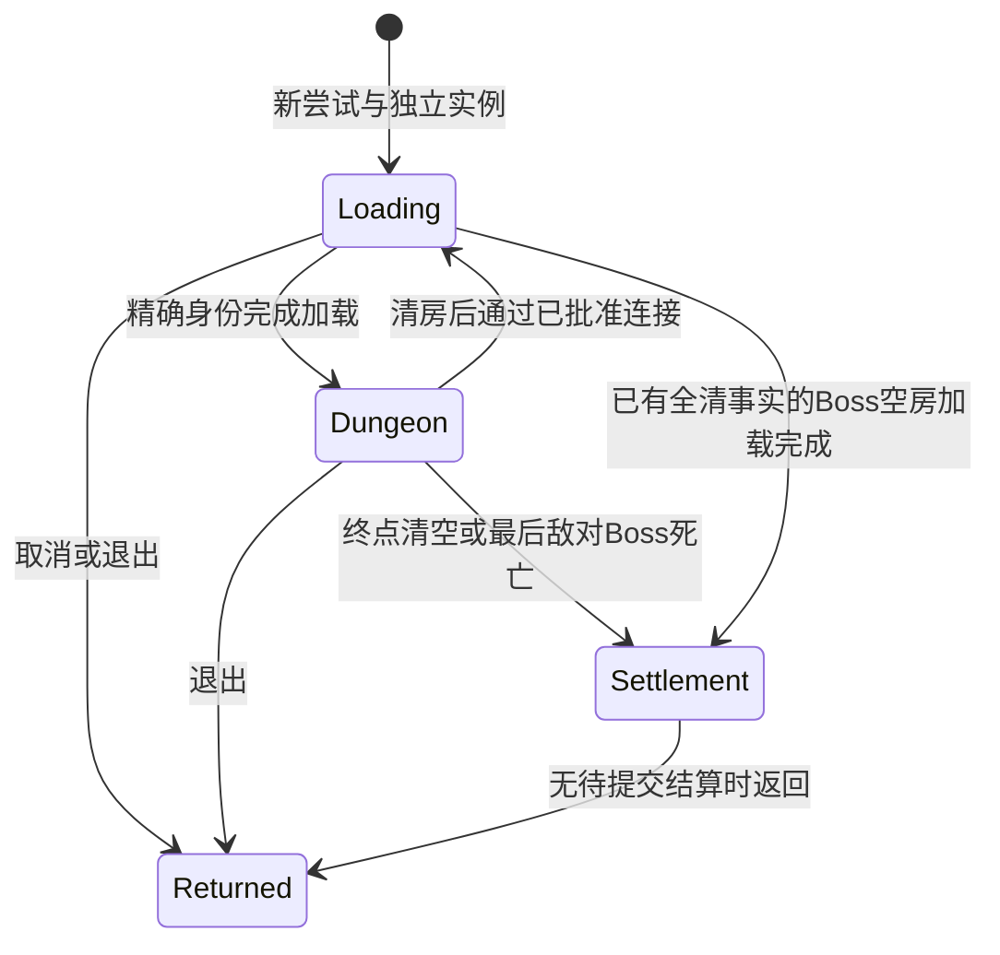

# 正式单人实例领域底座

## 普通图疲劳owner

`Fatigue`统一表示156点基础额度、黑钻188点上限的疲劳值，`Stamina`表示退图后随时间恢复的虚弱状态，两者不共用余额、期限或恢复入口。副本无参数`[no fatigue]`仅关闭本次Fatigue费用，具体资源语义见[副本目录](../资源/副本目录.md#数据与边界)。

当前Runtime默认开启[开发GM](../开发/GM.md)的无限疲劳开关：选角及房间加载通知始终显示实际上限的满值，普通房间加载不扣余额、不写余额扣点receipt或疲劳revision；原真实疲劳存档保持不变。服务端应耗疲劳仍按下述首次房间规则累计，零余额不影响计数。GM关闭后恢复原余额准入和扣点，重新选角或下一次加载使用真实值；服务重启恢复开启。未初始化的疲劳owner仍拒绝普通入场，不将未知存档伪造成正式费用来源。定向 `--selftest-tcp gm-debug` 检查满值投影、存档不变、重复加载及关闭后一次扣点。

应耗疲劳与余额分开：`SinglePlayerDungeonRun.CompleteLoading` 在成功加载普通地图时按现有实例/MapID账本口径累计一点，通过不可变 `DungeonRunSnapshot.ConsumedFatigue` 随 `FormalDungeonReceipt` 提供给进度或结算消费者。同模板出现在不同格或dummy阶段时，演员、死亡和缓存身份独立，费用仍按MapID去重，不能让Run应耗量超过本服账本实际口径。计数不读取无限开关、角色余额或客户端上报；重复加载、已加载房间回访、失败和旧身份均不增加，预留或移动到Loading阶段也不提前计算。修炼场及当前免扣点的任务专用路线为零。计数归当前Run，新实例从零开始；断线或服务重启结束该Run，不保存跨局活动进度。

这一分离方式参考S4A21的 `Game/Events/FatigueShopRules.RequestedCoins`：按当局首次房间计算应耗量，独立于真实疲劳余额；其活动再解释PVF固定入场消耗、燃烧倍数和每日奖励上限。本版沿已有普通每房一点规则提供原始累计，不在无限疲劳开关中创建活动奖励或复制其他版本的费用算法。

普通请求使用任务身份0、槽位FF和空接取Guid，实例仍沿唯一InstanceId、持久尝试号、选角epoch及完整角色revision建立。成长与结算账本明确允许0，不将其映射到任务3145；原剧情清图和领奖外键、记录及资产保留。

`local-normal-first-room-fatigue-v1`是本服普通路线的首次房间规则：入场需完整疲劳值owner；没有`[no fatigue]`时还要求Remaining大于0，同实例每个不同地图首次成功加载扣一点，Used与Remaining分别钳制在Maximum和0，已开始实例允许继续完成。有该标记时保留原owner与余额，允许零余额进入，不生成扣点结果或增加应耗量；道具消耗及退图虚弱仍按各自资格处理。回访已支付地图不重复扣费。扣点与角色revision同事务，最小地图扣点结果随本实例缓存并在COMMIT成功后确认，之后才进入Dungeon并投影实际NOTI36。存储返回不明时保留Loading和原角色快照，暂拒退出，同次加载重试核对已确认结果；未确认且持久前提已变化时拒绝重扣。

`local-start-dungeon-fatigue-v1`是本服的入场一次性疲劳规则（#511）：普通入场的副本声明唯一一段`[use fatigue only start dungeon] N`（N为单个正整数）时，`DungeonEntryPlan.StartFatigue`冻结N，`UsesRoomFatigue`为假，首次房间不再逐房扣点。准入时库内余额或客户端投影余额小于N以`start-fatigue-insufficient:N`拒绝，不扣成负数；入场提交`CommitDungeonEntry`在同一写事务内复核疲劳owner、扣N、推进revision与尝试号，并与同次的[入场票](副本.md#入场票与准入原因)一起提交，任一步失败整笔回滚。以起始地图为键的扣点结果只保存在本实例缓存，成功提交后确认；准入失败清除未安装实例的候选，不修改旧实例。应耗疲劳在首次加载时一次计N，后续首次房间不再累计。无限疲劳开关下不扣余额、不生成扣点结果，应耗量仍计N。重复或畸形的声明不猜测，保持逐房一点并在入场日志`EntryCostNote`中记录；深渊派对、强袭、练习、比赛、回放和任务路线不使用这条规则。该字段在客户端上的确切语义（是否仅为显示）尚未实证。

owner保留Used、Maximum、UsedMaximum、Remaining、ContextAuxiliary和SelectionAuxiliary，后面三个附属字段不由经验或等级推导。新正式角色接此前实际投影的0/156；v19为已有同账号副本owner、缺疲劳记录且无历史扣点receipt的旧角色补齐相同初始状态，避免旧任务分支升级时已存在空疲劳表而漏建记录。没有副本owner或已有扣点历史而缺疲劳状态的角色保持未知，不用初始值覆盖历史。任务专用路线保持当前master的费用行为，本普通规则不附加任务扣点。

每日按服务端本地时区06:00恢复：Used清零，Remaining恢复至当时有效Maximum，普通156、有效黑钻188；不累计错过的天数，保留UsedMaximum及两个Auxiliary。最后恢复服务日随疲劳owner持久化，重复请求、重选、重连和重启不会重复补满，墙钟回拨不回退日戳。新角色记录创建服务日；旧记录缺日戳时首次选角恢复当前服务日一次，迁移本身不重写余额或补造历史日。

选角先恢复跨日疲劳再构造ACK4；在线角色由当前连接的可取消定时器在06:00提交后入队NOTI36，普通请求前亦补查，覆盖停机、休眠或延迟唤醒。未决资产、死亡、疲劳、结算或转场暂缓恢复，待原操作结束再处理；不清除当前实例、已付房间、掉落或应耗量。切换角色、接管与断线取消原任务，发送前复验generation、选角代次和实际疲劳值，余额变化后的旧通知不能覆盖新余额。`fatigue-daily` TCP覆盖城镇/副本双账号在线日切、原生通知、同房去重、继续过图及离线补齐；核心自测覆盖时区、回拨、黑钻上限、事务回滚和持久化恢复。

普通怪物等级采用明确本服规则：相对标志非零时取副本PVF基准等级加原第三整数，否则保留绝对整数。该选择不宣称恢复模式9上下文getter或原服的在线等级算法；NOTI29使用显式生成等级，原始全部整数和品级保留。冠军空附加集合单独解析与生成，未知正数量仍拒绝。机关召唤、全部普通地图机制及客户端实际通关还需分别验证。

普通特殊父对象与其资源`[monster]`子actor沿同一正式路线预留对象key，包含在NOTI29中，仍归原Run所有。父对象保留脚本与全部子规则，子怪保留完整五整数声明、显式等级、独立key及父索引，不用额外在线状态或网络请求补造生成。子actor不充当普通房间阻塞目标；收到已宣布key的完整原生统计后只消费同房子actor存活状态并发送死亡收尾，不将该事实混入普通经验/掉落账本、ClearFact死亡集合或任务进度。这个非奖励收尾不提供机关奖励已实现的证明，资源附属奖励及实机互动仍须独立闭合。

普通死亡沿最新任务系统的正文检查、参与者归属、当前Run已发布存活对象及稳定事件去重合同，不将客户端HP、次数或改写统计作为服务端伤害模拟。普通机关子actor仍只做非奖励收尾。普通退出先提交本次入口外安全返回点，再结束原Run；位置提交失败保留实例，不覆盖成长、任务或资产。

多人普通、任务与现有深渊复用本页Run及个人资产账本，由共享实例协调物理路线、加载和死亡事实；多人事务、任务助战及退场边界统一见[组队副本](副本.md#组队普通任务与深渊)。不能绕过共享实例独自推进其中一个成员的Run。

## 当前合同与范围

[SinglePlayerDungeonRun](../../Server/DfoServer/Game/Dungeons/SinglePlayerDungeonRun.cs)提供独立单人实例的内存生命周期、房间对象身份和已确认事件去重。GameSession私有正式状态接入任务及普通单人入场、加载、死亡核验、成长事务、冻结掉落拾取、过房、Boss确认、通关经验及退出。任务猎杀、清图、物件和掉落复用本实例与原子持久化；普通免费牌、金币付费牌、黑钻额外奖励及黄金牌每日免费次数已接入，满背包物品通过永久邮件保存。所有合法职业及转职角色均可走入场，成长仍须符合[角色成长](角色成长.md)的来源核算规则。既有[诊断实例](../../Server/DfoServer/Development/Dungeons/DungeonProbeRun.cs)由独立开发模块管理；其 `ReportDeath` 不是正式死亡事实来源，也不参与本领域底座的状态转换。

资源结构及原码边界见[副本资源解析](../资源/副本目录.md)、[副本选择与固定场景](../协议/副本.md)。当前 `DungeonCatalog` 保留 greed 原文，提供 AA..PP→0..15 的线性索引、原文偏移及逐 maze Unsupported，并通过 `StaticTopology` 检查显式地图的门墙出口、双向连接和可达性。静态连接通过仍不能证明动态门、特殊传送和正式准入资格。当前正式接入任务唯一显式静态路线与匹配的死亡包体，不外推动态门或特殊传送；缺少 `approvedRoute` 或 `combatAuthority` 时 `TryCreate` 返回 Unsupported，不把测试中的合成怪物与战斗事实用于正式玩法。

## 再战魔界双槽生命状态

参与者record不是同账号授权凭据。TagEvildomAdmission须经原CommitDungeonEntry事务复核真实编队、双方账号/95级非PVP资格，和正式attempt/key预留一起写入固定准入回执；正式入口安装调用者见下述专用准入，不能据领域存储测试宣称客户端已经可入图。

`SinglePlayerDungeonRun` 内的 `TagEvildomRunState` 保存已批准参与者的固定主备快照、编队revision、active ordinal及两槽的存活/死亡serial/复活截止，不另建在线owner，也不改变 `GameSession.Selected` 的登录主角。只有已存在、初始Loading中的9608/400000095 Run且主角ID/revision与免经验/疲劳/退出惩罚声明一致时，才具备安装条件；安装不单独授予准入：正式调用者必须先通过type53、真实Stadium popup、已发布双角色资料及日周资格，再随原attempt预留事务写固定准入。1468/1469仅消费已安装Run，不根据单字节请求临时生成状态。

生命状态沿普通单人玩法的本机死亡报告信任边界，不新增连续HP/MP权威。匹配客户端允许本机TAG context中的非当前Actor报告死亡，因此两槽的首次有效报告都可受理；仅当前槽死亡才选择另一活槽。重复死槽不续12秒、不递增serial；双槽已死才产生可编码1469败北成功的结果，并清除所有复活截止。非终局不发会导致败北的成功ACK，改以1407切活槽、截止后1676复活，是本服依据已证消费者制定的兼容顺序，**不是原服完整抓包证明**。当前不强加固定5秒切角冷却：本版另有1.5秒fever分支，后续准入不能把未知fever状态当作普通冷却。

复活等待复用连接的 `CommandGate`、`TimeProvider` 与取消令牌，一连接最多一个任务；事实仍只归Session内原Run。发布绑定owner generation、选角epoch、实例/当前房间身份、死亡serial与本次提交快照。Loading阶段不受理切角/死亡、不发布复活；原实例随后合法加载时仍可消费已到期但未取消的截止。回城、清理Session和断线取消旧生命周期，双死也使旧定时任务失效。协议不携Run或死亡serial，因此不能区分任意久远、重编码后与当前合法单字节报告相同的旧包；内部回执校验不宣称解决此原生限制。

正式接线由专用6B15冻结DGN与五候选之一，紧跟的25B16须匹配同一owner/epoch/selection/双角色来源，才能沿原正式Run建立场景。该入口的25B16末位 `unknown21` 为 `FFFFFFFF`（普通副本为 0），只对9608/400000095放行，字节依据见[25B16 末位字段](../协议/副本.md#安徒恩战况表正式进图)。Stadium无普通worldmap，不给普通选图追加假资格。TownUI select_mode在客户端本地选择mode3/4，因此允许9608/400000095，不能以1678初值3锁死困难。不把再战专用本地快槽映射到CMD44扣主背包。1679只投影真实提交后的展示值，不授予领奖资格。普通Run合成夹具验证生命周期，不充当生产资源资格；真实客户端solo切角、自机UDP分发和完整死亡顺序仍待验收。字节及静态证据见[再战魔界生命与结果展示协议](../协议/副本.md#再战魔界生命与结果展示)。

普通DIE_CHARACTER、USE_COIN及其10秒死亡回城不会受理已安装TAG状态的Run。普通怪物死亡仍经原authority核验和去重，但只确认内存事实，不规划普通经验、地面loot或任务掉落，不改角色资产revision；Session与Repository的公开成长提交也明确排除TAG。普通拾取、丢弃及物件任务事件在规划前拒绝，避免物品落到不可拾取地面。Boss死亡不会产生普通ClearFact、任务RoomClearFact、物件通关或零经验翻牌结算许可；双死败北不能继续房间/怪物推进，仍允许42退出。TAG终末只使用下述独立真实到账合同。资源准备阶段也跳过普通怪物/任务掉落规划，不在basis135下额外加载无关普通经济资源。

### 固定准入与原子领奖合同

迁移103的 `account_tag_evildom_runs` 是准入/结果回执，不是资产或另一套在线owner。admitted固定同账号队首、备用、teamIndex、配置revision、instance、主角attempt及小奖励表资源指纹；它本身不证明通关。新合法准入在同事务清理该账号旧admitted，最多保留一个未完成尝试；已完成历史不裁剪。

`account_tag_evildom_challenges` 按账号、UTC+8业务日和队伍槽位保存当天固定maze、最近正式入场难度、实例及未完成/明确退场/通关状态。只在正式入场attempt/key事务中写入；失败重进、切难度、重置编队和重开服务不刷新本槽位对手，新业务日允许重新选择。此表不外键到角色，删角不能清掉历史占用；旧库升级只建空表，不根据旧admitted猜路线或追补次数。

每天05:30（含）至06:00（不含）禁止准入；15选择与16正式安装分别复验日界和关闭时段。每日05:40由连接唯一可取消任务主动沿原退场事务返回中央竞技场，Loading、战斗及已完成结果页均适用，不依赖玩家发42。任务绑定owner generation、选角epoch和实例；回城/断线/换角取消，旧任务不能作用于新Run。待提交终点及奖励不丢弃，原提交结束后再回城；忙锁释放命令门禁后重试。

日界前明确退场或被05:40正常送回的失败尝试不占周次数。到06:00仍未明确退场或通关的尝试占其原周一次，重复读取不重复累计；周一日界的旧周尝试不占新周。不生成假clearance、角色保护、邮件或奖励，迟到退场不能撤销旧日占用。每队每日成功一次、账号每周三次的原通关限制继续成立。

只有带固定准入的Run在原Native权威确认真实终点后才产生专用候选；普通死亡确认不能提前将它settled。待提交死亡同时阻止过房、切角/死亡、到期复活和42。调用方必须在同attempt冻结终点event、资源抽样、完整附件、首个可信终点时刻的日周归属和真实耗时（非负64位毫秒，不设未证的一小时通关限制）；只有1679显示投影限制为3600000毫秒。数据库结果不明保留原候选，不能撤销重抽。Session按TimeProvider单调时钟从首次真实加载完成计至首个可信终点，包含后续加载；这是本服明确起止边界，不冒称原版是否扣除加载的规则。

本服经用户确认：一队每次真实通关一份邮件，固定给登录队员1，不看胜利active槽；两角色同时记录通关。奖励从 `etc/tagtournament/tagevildomgathering.etc` 万分池选择一个结算定义，再复用booster解析展开确定性产物，不将490012774等抽象结算卡牌当箱子发放。真实产物为账号材料胜者之义/强者之利，困难稀有项另含六种账号宝珠之一；按统一物品创建规则生成完整核心。

同一owner外层写事务检查固定准入、当前真实终点/attempt、双方归属/资格、本队身份及日周限额，原子插入B通关账本、复用 `DeliverMailInTransaction` 投递单份永久邮件，并一次完成原准入receipt。其它队/无意义配置revision变化不替换本队也不阻断合法Run。已有完成receipt优先匹配原event、冻结附件、时刻和耗时后只读回放，不重新检查自己已占的额度，不重抽或重发。mail_id只作历史投递编号；删角色/邮件不删通关与receipt、不返还额度，历史附件JSON不是重投资产源。

42回城先沿原Run/TravelReceipt结束实例和旧复活任务，保留已发布双角色，由真实24的原生离图恢复队首、技能及UI；只刷新1678，不再覆盖普通Actor/Player/技能或重建1393/1394。不在战斗或每房间重发1394。原Selected仍是登录队首，active1不改变邮箱或账号owner。备用变化允许一次有界重捕获；已经发送部分pair或主角实际投影源失效时沿完整小退恢复。尚未安装pair而备用需要规范化时只提示并拒绝准入，不冒称自动修复或将未发资料标成就绪。已发布双角色只在主角身份、账号钱包版本或备用投影到期时失效；城镇里采购、修理、体力恢复等只改主角自己的记录，CMD15准入前据此就地重发一次1393→1394，不把一次修理变成重登要求，重建失败仍按原准入规则拒绝。

1679仅在SQL提交并确认Run终态后发出，成功写出后绑定原Run的once标记；终点重传不再次弹结果窗。1678与邮件提醒仍允许幂等重放，避免结果包后临时数据库忙丢失后续通知。断线重登只恢复真实邮箱/已通关保护，不恢复旧战斗或重发奖励。

## 状态与身份

正式副本上下文通过 Session 独立持有的[运行态缓存](运行态缓存.md)保存，底层为 MemoryCache。怪物编号、Run 房间回访及 Ground 未拾取物品仍是原对象，不维护第二套副本状态。非副本状态、回选角和断线结束缓存；同 index 再挑战也必须新建实例。有效副本不使用 TTL 或自动淘汰；房间疲劳去重随原实例保存，死亡冻结及其实际拾取结果另与业务同事务持久化。缓存丢失后，同一原Run的原合法准备可从当前格式回执复验完整结果；这是仓储级去重支持，不实现Session冷Restore、Ready握手或已结束Run的重建。四类退役明细与格式0历史集合原样保留，不补发或处理旧局。

对象key是16位场景编号，不是角色终身玩法额度。新实例优先沿用已存游标，整条路线（含地面预留）放不下时从256完整重试一次；准备失败不写角色或尝试号。同一实例内不回绕，怪物、特殊对象、地面对象和库存丢弃继续共享唯一编号；成功提交的新实例使用新Guid与单调TaskAttempt。回访已加载房间仍复用原对象，不能每次进房清零。数据库账本的实例作用域与存量迁移见[数据库](../开发/数据库.md)。

新实例只通过既有正式准入及场景切换安装，Loading阶段不接受战斗/拾取，旧Run回执不能发布。游标延续避免相邻小型挑战立即复用相同编号，但服务端Guid/attempt并不随原生死亡或拾取请求传输；不能据此宣称能识别任意久远、重编码后与当前合法请求相同的旧包。连续入场、再挑战及跨实例缓存的客户端行为仍需实机验收，数据库去重不能代替此边界。

`DungeonRunIdentity`包含角色 ID、任务 ID、TaskAttempt、实例 Guid 和当前 epoch。开局角色 revision 单独保存在 `StartCharacterRevision`，不参与所有后续事件的永久身份比较；正式持久化必须以当次角色 revision 作 CAS，合法的经验或掉落事务不会使实例身份失效。

调用方在账号 owner gate 内分配任务尝试并建立实例，每次挑战分配新实例及新的尝试/epoch。完成加载、接受过房、结算和退出会推进 epoch；房内死亡事件不逐次推进 epoch，以允许同一房间生命周期内的多个已确认事件。epoch 不回绕，并为终止预留空间。断线、重选与 owner 更替由会话层使旧实例失效；本底座不负责 owner 或持久化，也不提供重启恢复。

## 调用接口

- `TryCreate(entry, taskAttempt, initialEpoch, approvedRoute, combatAuthority, out run, out reason)`：只在身份、完整房间计划、明确连接和正式战斗输入能力齐备时建立 Loading 实例。
- `CompleteLoading(identity, actionId, hasMatchingQuest=false)`：仅当前 Loading 状态可接受，随后更新 epoch。Session在锁外从真实角色和Run绑定的接取规划sub11资格，提交前复验角色引用、选角代次、Run与identity；成功加载保留只读加载事实、缓存及初始化统计，加载拒绝或精确重放不加数。该统计不写玩家库，任务达成仍由真实清图事务决定，详见[任务系统](任务.md)。
- `Move(identity, actionId, target)`：仅当前 Dungeon 状态、本房清空、实际声明的连接及已规划目标房间可接受。
- `Return(identity, actionId)`：可在 Loading、Dungeon 或 Settlement 取消/退出；待提交死亡或结算期间拒绝，接受后成为 Returned。
- `AcceptConfirmedDeath(confirmedEvent)`：只接绑定战斗事件来源签发的类型化事实，禁止直接传入客户端的死亡字段。
- `PrepareConfirmedDeath(confirmedEvent)`：核对同样的死亡资格并冻结待提交候选，当前死亡集、epoch及清图状态不变；精确重放返回同一候选。候选提供提交后快照及可能的清图事实，供持久化事务使用。
- `ConfirmCommittedDeath(prepared)`：存储明确提交后，在原实例owner内确认准备对象并发布冻结结果。重复确认只返回Duplicate，不再次输出清图事实。
- `ConfirmCommittedPassiveObject(identity, operationId, templateId, sourceOrdinal)`：原Session明确提交场景事件后确认批准路线中的唯一物件条件；精确重放不重复输出清图，物件操作不加入战斗死亡集合。
- `PreparePassiveClear` / `ConfirmCommittedPassiveClear`：具有原实例完整真实死亡集合（可为空）的终末物件冻结独立来源和提交后快照；原场景事务保存来源及任务进度后，才确认结算。待提交期间拒绝死亡、过房或退出；失败及返回丢失复用原准备。来源存储和领奖规则见[任务系统](任务.md)。
- `CancelUncommittedDeath(prepared)`：仅在存储明确未提交或已回滚时撤销准备，使原事件ID可再次准备。旧候选、另一实例候选或重新构造的候选不能确认或撤销当前准备。
- `ClearFact`：末次死亡提交确认后保留唯一只读清图事实；复制字段不能替代原对象取得结算资格。
- `PrepareSettlement(fact, reportBody, reward)`：冻结首份报告和奖励；精确重复复用原准备，报告或奖励改变时拒绝。
- `ConfirmCommittedSettlement(prepared)`：仅原实例当前准备可确认；重复确认不重复发奖，提交结果不明时保留同一准备查询receipt。

返回值包含 Accepted、Duplicate、Rejected 或 Unsupported，以及只读当前快照。已接受 action 的 ID 与完整输入保存在实例内；精确重放只返回 Duplicate，不重新切房、推进 epoch 或输出清图事实。复用 ID 修改身份、动作或目标被拒绝。未接受过的旧 epoch 输入被拒绝；已接受的旧事件重放可以识别为 Duplicate，且没有业务副作用。

## 路线与房间边界

`DungeonFixedRoute`是领域准入计划输入，包含全部房间怪物计划及显式双向连接；资源定义及门墙资格仍归 `GameWorld`。连接只能由已审核的匹配资源规则提供，或在 C# 单测中明确作为合成 fixture。底座不解析 PVF，也不根据相邻坐标自动补连接。

创建时要求房间与 entry 的显式 map specification 完整对应，坐标唯一且位于边界内，start/boss 确实存在；连接端点存在、距离为一个格、无重复，全部房间从起点可达。即便地图相邻，只要没有明确连接，也不能穿墙。怪物计划按[副本模块](副本.md)支持的固定普通/Boss规则及entry的副本基准等级重新核验，传入等级与生成类型必须与同一原资源行的规划值一致；仅允许按entry正精英概率，将可战斗非友方的普通资源行从type0提升为type1，其余变化仍拒绝；未知生成条件、缺失行、重复怪物 key、角色 key 冲突或不完整计划不能变为空房。

普通地图种类沿用目录解析的`map`，Boss为`boss`；`normal`不是地图目录的合法种类，不与怪物的`[normal]`品级混淆。回归以真实3145地图身份、静态连接及明确合成怪物/战斗来源验证字段可接入底座，不能将该测试视为真实怪物或正式副本已经支持。

房间加载确认、死亡集和清退集归各自固定房间，剧情阶段及条件替换房间不共用坐标缓存。首次进入使用完整 NOTI29 Build；完成加载后普通回访使用 Current/Cached，叠层结束沿既有 RestoreBase/Cached 恢复基础房间。缓存通知不重发地图 ID、机关父子演员或物品列表，由客户端恢复原 MAP 上的物件和地面状态；服务端保留原死亡集，不重复生成、奖励或消耗疲劳。新实例不继承旧加载缓存。该显示缓存与 sub11 的初始化计数分开，仍保留 `individual map movement` 两种统计合同。同一实例所有房间 key 唯一；新实例可以拥有相同数值 key，但旧实例/尝试/epoch 的事件不能影响新对象。被动对象、buff、碰撞、机关及其他机制没有在此底座中实现；其存在不构成已实现交互的声明，生产准入仍须有独立资格，未知机制不能因为目录可读取而默认支持。

全非战斗基础Boss图的ON START MAP演出明确CHANGE MAP，且批准路线在同坐标只有一个带唯一可报告脚本Boss的末层时，Run冻结该层为实际结算终点，NOTI28保留基础Boss坐标。仅原路线有效接取、无独立清图条件及无其它终点覆盖时适用；不从演出通知创建死亡。3991的77037→77038及75100退场沿此规则生成真实末层ClearFact，基础图加载不提前结算。

资源限定的非战斗演出末层可用原生kind1恢复原基础Boss房间，即使演出演员仍存活。资格仅来自本层MAP的唯一basic action、LIMIT 1单次无条件CINEMATIC、同MAP的SCENARIO/MOVE ALLOW0、各场景ALLOW DAMAGE0及独立CHANGE MAP行为；可选声明损坏或不支持时不授予豁免，原MAP及演员主资源继续严格校验。Run仍要求最后一层、当前加载身份、原基础Boss来源、显式清图终点和唯一原路线接取，普通0入口从冻结接取列表核对，不能伪造非空请求Guid。待提交死亡、结算、后续叠层和错误kind不放行。返回只恢复缓存，不写演员死亡或清退、不发经验、不完成任务；基础Boss仍须真实死亡才生成原终点凭据。`--selftest-core`验证资格与重放边界，`--selftest-tcp quest-chains`覆盖3444完整路线、两种入口、34/46顺序及重连，客户端演出与实际请求时序另行验收。

同坐标仍有下一叠层时，精确10 token的ON START MAP动作也可提供CINEMATIC身份，但必须同时满足上述同MAP非战斗CHANGE MAP声明，才允许kind1在当前演出演员未清时推进下一层。该动作不取得未清末层返回基础格的资格；没有CHANGE MAP证明的叠层继续要求清房。3452的D156起点依资源顺序从70202推进70351，70351不能仅凭进图演出返回基础格。导航不生成死亡或清图事实，已进入层、未决提交、加载身份及特殊模式门禁继续沿用原Run规则；资源回归通过`--selftest-tcp story-scenes`执行。

APC进图演出采用独立来源资格：完整ACT须声明`ON START MAP / WHICH / AI CHARACTER / IS INDEX`、`CHECKUP OBJECT 1`、唯一CINEMATIC及四槽`CHANGE AI NORMAL 0..3 none.ai`，并匹配当前MAP唯一同模板APC。对应同MAP演出须为SCENARIO、MOVE ALLOW0、各场景布尔ALLOW DAMAGE，含伤害场且末段是独立POS演员的CHANGE MAP；不能借此放宽原非战斗谓词。该末层只沿原kind1恢复已加载基础Boss缓存，并核对原迷宫三整数任务连接与难度，保留其余存活演员及原死亡集合；演出任务不伪装为clear-map任务。正式任务回放可用原冻结路线和空任务实例身份复用这项导航，不伪造活动接取；普通任务仍核对唯一AcceptanceId。3599的76113/CMT2405由此支持未全清返回；导航不执行APC条件、AI或演出销毁，不签发死亡、清退、经验或任务完成。实际触发时序和报文仍属客户端验收。

物件附加ACT若唯一声明同坐标五整数`MOVE MAP`且场景标记为1，Catalog冻结原MAP、物件序号/ID/路径、ACT索引/路径和完整五整数。对于任务清图目标已落在资源基础Boss、仅因同ID异坐标演出层生成终点别名的路线，Run核对该返回声明后保留基础Boss为真实终点。kind0恢复已加载基础房缓存并推进实际房间epoch，37完成正常加载；随后可继续相邻房间。演出层死亡不清图，返回后旧epoch和旧演员key不能替代Boss死亡；未决死亡、结算、任务、通讯或翻牌事务阻止导航和加载确认。

6032的演出层59914位于(2,0)，其ACT返回基础59913后，真实基础Boss59914位于(3,0)。客户端原生脚本在该Boss房读取演出保留的`c=1`并销毁70215，真实39才形成清图；返回请求本身不生成死亡、经验、任务或结算。`quest-chains`覆盖显式/普通0入口、演出层存活或已退休、迟到包、34/46顺序和重连；匹配客户端的自然回调与39已另行实测。

若路线另有独立`QuestClearMap`，仍保留原末层呈现合同：NOTI29使用RestoreBase/Cached，实际房间、演员、epoch、ClearFact和结算地图属于原末层。Run另存本实例呈现许可，37只确认呈现，重复45/37不重复加载、消耗疲劳或发结算许可；原接取绑定沿入场冻结身份保留，不因34清槽失效。附加声明缺失、损坏或错绑时，不获得脚本返回豁免。

重复坐标剧情路线仅在完整批准路线的每个非末阶段均为唯一阻挡假Boss的 `[dummy]` 地图、且末阶段有真实Boss时，将初始小地图目标与最终通关地图分离（如任务3344的76327→76328→76329）；非dummy剧情阶段保留原终点标记。前两张真实 `[dummy]` 地图中的假Boss死亡，经原死亡事务提交后用NOTI38发布下一阶段坐标；回滚、重放和其它怪物死亡不推进标记。新阶段替换已访问坐标时使用 `Current/Refresh` 清除旧场景缓存，普通回访仍使用 Cached，不能叠加两套门或重新生成旧演员。通关资格始终保留资源最后阶段；断线结束Run，重进从新的实例目标开始。合成边界与真实3344路线均有回归，客户端画面仍需独立验收。

## 假Boss迷宫

MAP级`[type] [dummy]`与怪物行的`[dummy]`修饰不同。普通迷宫声明假Boss次数且MAP反向池存在dummy成员时，入场准备每格的基础图，以及按本次随机路线冻结的假Boss阶段和最终真Boss；运行时只激活一个当前Boss目标。D51为两次假Boss后进入真Boss。当前目标的MAP级dummy原Boss行保持生成类型3，本版客户端由该类型与MAP类型2共同建立Boss和假Boss标志，不能沿用旧端降为精英1的发送方式。服务端的`IsDummyMapBoss`负责目标推进与排除最终Boss资格，`RewardType`独立保留旧端的奖励品级1，经验和掉落不随显示修复提升；真Boss仍使用品级3。原始资源行、对象key、阵营及阻挡资格不改写，普通MAP的`[boss]+[dummy]`脚本修饰、APC及被动子actor不借此转换。

没有当前Boss标记的候选格优先使用本位置的普通`map`模板，提前访问不能激活后继阶段。显式候选混有`[normal]`与`[dummy]`时先按房间用途分组，再冻结实际地图；不能先从混合列表抽出dummy并将其冒充普通图。D51三个候选格的普通图分别为58952、58953、58954，dummy为58908、58909、58910；当前目标优先使用本位置声明的dummy，不因同出口而选中其他任务模板。确无普通模板时可以借用dummy场景，但普通身份不创建其中原`[boss]`行，其他怪物保留原行索引、阵营及独立对象key，既不产生幽灵阻挡，也不接受被排除演员的死亡。当前目标格加载dummy后仍保留当前标记，只有其中dummy演员死亡事务提交后，才更新唯一目标与Run epoch，并通过该次NOTI38发布下一坐标；待提交、SQL回滚、重复死亡及重放均不能提前或重复推进。假Boss死亡不产生通关许可，房间仍需清完剩余阻挡演员才能过房；最终真Boss沿原ClearFact与结算链路完成。

普通回访复用已加载的房间、死亡集合、被动物件和地面缓存，不重选地图。后继目标已激活后再次进入该坐标，才替换此前的普通或旧阶段缓存，用NOTI29 `Current/Refresh`发布新地图与独立演员key。原端在当前dummy入场时预选内部下一目标（08307ECA），死亡包才将其公布给客户端；本服预先冻结完整序列，在死亡提交后发布实际当前目标。断线结束整个Run，所有状态归原实例，无新增存档或平行在线状态。

## 特殊对象物品掉落

[DungeonPassiveDropPolicy](../../Server/DfoServer/Game/Dungeons/DungeonPassiveDropPolicy.cs)读取 DGN 的 `[special passive object item]`，按 MAP 特殊父对象的 `[item]` 五整数解释组索引、指定抽取次数、通用抽取次数及保留参数。引用按组的实际声明顺序定位，组头首整数作为原标记保留、不代替vector位置；重复块沿两端读取器的清空规则由最后块替换。物品 ID 保持 32 位，空组和不掉落区间不补保底。指定抽取沿 `df_game_r` 的绝对累计权重和 `0..10000` 闭区间，一次抽样最多选择一个条目；权重总和10000仍保留上界空值。每个带物品子项的父对象占一个从0开始的关联槽，同父多条子项共享该槽，不把组号或全部父对象序号当成物品关联槽。

DGN 存在物品池不代表当前路线必定掉落；实际加载的 MAP 还须由特殊父对象的 `[item]` 子项引用该组。普通静态 `[passive object]`、空组或未被当前地图引用的旧资源，不因此自动获得掉落。

通用抽取使用 `etc/itemdropinfo_object.etc` 自身的概率、难度和类型矩阵、稀有度及等级引用，共享既有金币引用和物品候选目录。金币、普通堆叠品及装备独立抽取，通用抽取先于指定池；物品创建复用既有完整 Core 和装备种子规则。当前资源的配方和神器通道为0；这些独立类别尚未绑定，遇到非零声明明确拒绝该准入，不静默改成其他类别。训练、修炼场、职业体验及显式禁掉落副本不生成此类奖励。次数需符合已核验的有符号字节消费者；完整房间最大输出超过255时拒绝，不截断合法批次。

资源解析、抽样和 Core 创建在准入 owner 锁外完成。实际父对象、子项、关联槽、完整物品或金币与独立地面 key 只冻结在原Run的地面状态中，不保存生成记录。准入事务仍保存 attempt/key 高水位，成功后通过 [NOTI29 的21B物品行](../协议/副本.md#特殊对象物品列表)发布；不写怪物死亡、经验或清图回执。参考 DFLegacy 的入房关联流程，显示与打击动作由客户端父对象管理，不额外要求客户端先报告普通怪物死亡，也不把关联建立当作服务端已验证树的受击次数或HP。

拾取复用原 `DungeonGroundState`、`DungeonPickupPlanning` 和库存事务，核对原Run、已加载房间及冻结来源。普通物品、装备、金币和既有账号货币均按完整数量接收，满包或超限保留地面。实际UID、钱包和revision同事务提交，最小拾取结果保存在原实例缓存，COMMIT明确成功后才确认。SQL回滚不重抽，未提交候选不能按成功回放；调用返回丢失后只复用已确认结果。无法确认且持久前提已变化时拒绝重做，不再次发物。缓存回访不重新发送物品，已拾取不复活；断线结束Run，重登只读取已提交资产，不恢复旧局。生命周期见[实时副本回执](运行态缓存.md#实时副本回执)，旧表结构见[数据库](../开发/数据库.md)。`--selftest-core`覆盖格式、随机边界、关联与独立21B预期；定向 `--selftest-tcp dungeon-passive-items`覆盖真实SQLite资产提交、拾取回滚和结果恢复，不将该组的仓储断言称为客户端实机证据。

特殊物品与普通怪物的缓存拾取结果统一保存普通库存内部64位UID及完整Core，不把UID写进装备品级或物品数量。该UID不是客户端地面key，现有时装/宠物的特殊实例键不在本功能中扩宽。

匹配客户端的配置树已有野草莓显示、拾取与原槽堆叠的验收，成功通知、库存及审计数量一致。该验收仅覆盖普通堆叠品，不代表本次缓存存储变更或所有原生地图、金币和装备的客户端表现均已验证。

## 战斗事件与结算

迷宫声明单一 `[destroy object]`、数量为1，且当前生成计划中存在唯一模板行时，Session将实际目标冻结到批准路线，原Run复验声明和物件行。原生迷宫条件有独立39来源，不要求OBJ另有quest type；仍核对完整正文摘要和绑定接取。空终点或友方终点加载不能提前结算；终末物件在原场景事务保存独立清图来源及本实例完整死亡集合（可为空）后才确认Run。物件条件可独立于任务进度变化，持久回执仍绑定本实例真实主任务接取。确认后保持已有真实战斗死亡集合，按实际终点与阻挡状态形成一次ClearFact，物件操作ID不加入死亡集合。回滚或提交结果不明时Run保持原阶段；恢复原操作取得有效回执后才推进epoch，过期投影不覆盖在线角色或确认条件。多实例、数量大于1及混合物件条件未接入；真实唯一物件的零击杀结算已接入，普通无scene的零死亡结算仍拒绝，不从模板数量推断事件，也不能借用单物件批准字段接入。

物件终点没有真实死亡key时，只发布空NOTI31许可结算，不伪造NOTI115。真实终点敌人仍沿115→31，已发布许可的实例不重复通知；任务33的ACK与库存/任务通知使用物件提交后实际phase和identity。`--selftest-core`覆盖物件条件、旧身份、唯一行及重放；完整自测覆盖真实3205的SQL回滚、结果丢失、过期回执和独立场景提交；`quests`覆盖真实3205/3210路线的33→31→46→34、回城与重连，客户端演出和自动回城表现仍需实机验收。

正式演出路线在其他真实战斗层完成原死亡事务、返回已加载的全非战斗终点后，已有ClearFact也可以没有终点死亡key。仅当资源明确该终点为当前地下城的type65 CinematicMapId、活动任务与Entry的qid/slot/AcceptanceId绑定且scalar0、真实死亡集合非空时许可空31；33或友方退休本身不创建ClearFact。该类实例须成功发布31后才接受首次46，之后允许正常34先清槽再结算，未决结算仍恢复原冻结事务。教程、职业体验、回放和独立物件来源不套用该演出资格。3599真实叠层及发布故障回归见[任务模块](任务.md)。

没有显式清图地图的路线中，基础 Boss 房若全部阻挡演员均为 `[dummy]` Boss，且同坐标末层的真实 Boss 模板集合与基础房相同，Run 将该末层作为实际结算终点。基础 dummy 和非末层死亡不提前产生通关事实，末层死亡仍经原 Prepare、持久提交和 Confirm 发布一次 ClearFact，记录实际末层地图；不补造基础 dummy 死亡。任务显式清图终点、剧情阶段及条件替换房保持原终点规则，真实基础 Boss、异模板或末层 dummy 不触发此选择。`--selftest-core` 覆盖边界、回滚与重放；`--selftest-tcp quests` 使用任务 3275 的真实资源路线验证末层死亡、46 结算、交付及回城重连。自动回归不代替客户端动画与结算界面验收。

真实基础 Boss 之后的单物件末层采用独立资格：原 maze 必须只有一个 `destroy object/count1` 条件，目标在整条批准路线中仅出现于 Boss 同坐标的资源最后层，且该层声明为 `[boss]`。Run 复验真实路线接取、槽位和 AcceptanceId 后冻结 `PassiveClearTerminalMap`，保留 BossMap、BaseBossMap、原拓扑及 wire 坐标；调用方不能预填这个字段。显式清图、末层别名、剧情阶段、条件替换、回放及特殊模式不借用此规则。

末层物件的真实事件准备清图时，基础房每个阻挡必须同时存在原房死亡标记、本 Run 的已确认战斗死亡及原提交准备引用，且至少包含一个真实普通 Boss。清退、非战斗退休、未提交准备和到达末层不能替代该事实；当前末层的原阻挡规则仍生效。场景提交、结果丢失恢复和 46 结算继续使用同一完整真实死亡集合，物件操作 ID 不进入战斗死亡集合。例如 3858 的 D193 保留基础 70484/70201，在实际 70487 的唯一 69292 事件后才可结算；单独的物件事件不归零 type65，也不放行任务 34。另收到绑定本次接取和实际演出地图的终末33后，普通34读取持久演出条件交付，见[任务模块](任务.md#场景条件周期与账号状态)。核心与资源回归覆盖资格、回滚、丢返回、重放及重选恢复；69292 的实际客户端生产者和演出达成仍未验收。

未拾取掉落在同一 Run 内跨房保留；回访完成加载后按当前 epoch 拾取，原死亡来源、完整核心、金币数量和 ground key 不改写。已拾取 key 不因缓存恢复复活，其他房间或加载阶段不能拾取原房物品。CMD43 只有真实空间/携带上限失败使用容量错误22；未知 key、重复、错误阶段及其他资格失败使用19静默解除等待，不误报满包。集合与兼容单件的死亡冻结及实际拾取结果同事务持久化，原实例缓存只保留运行期结果。

`DungeonCombatAuthority`只是正式战斗组件的事件签发能力合同，不是已经实现的伤害、HP、命中或防作弊系统，也不是 Runtime 默认创建的服务。实际战斗组件只有在服务端解析已确认死亡后才可签发 `ConfirmedDungeonMonsterDeath`；事件携带完整实例身份、非空 event Guid、monster key 及正的唯一战斗事件序号。不存在 `bool died=true` 的网络成功入口。

[NativeDungeonCombatAuthority](../../Server/DfoServer/Game/Dungeons/NativeDungeonCombatAuthority.cs)解释匹配客户端的[死亡统计报告](../协议/副本.md#过房与怪物死亡的字段)，并永久绑定同一实例。`RewriteFlag`区分客户端写入报告的两种统计方式；“改写”指客户端重写统计前缀，服务端不会修改收到的数据。

报告须来自真实会话owner及当前选角、实例和已加载阶段，并通过包体形状、wire宽度与正文检查值校验。Reporter为客户端上层报送上下文，原生发送者允许无上下文`FFFF`；贡献列表保留原序和完整值。Reporter、来源kind/key及所有统计字段只用于审计，不设置来源白名单，也不要求本人参与。客户端报告的生成等级、创建HP、累计扣血量、扣血次数、统计前缀及`RewriteFlag`均保留原值，不作为死亡门槛；不要求等级等于生成计划、HP或次数为正，也不比较普通统计关系或Boss改写公式。是否签发奖励事实由当前房间已登记敌人及其死亡状态决定，Boss身份与清图资格由正式生成计划和已提交死亡事实决定。

完整正文指纹由网络转换计算，随原观察保存；死亡事实按同一Run中的目标key去重，重复报告无需与首次统计或来源完全相同。检查值和统计字段不提供身份认证或奖励额度，击杀经验仍按服务端生成计划计算。

当前已登记敌人首次死亡才签发事件与序号；同房原提交身份的重复复用原冻结事实，不重复奖励。当前路线的友方/非阻挡对象退场及其重复报告回复空掉落NOTI38，退场只更新Run内显示集合，不写成长、任务或清图记录。未知、其他房间、旧Run、已结算普通敌人和清场目标仅审计并忽略，不回38，也不签发新的奖励或清图事实；缺少实际目标不作为身份拒绝门槛。明确SQL回滚后可用原冻结事实重新Prepare，结果不明时复用原候选及持久回执恢复；新报告的统计或来源不会替换已冻结计划。Loading、旧选角、旧owner、退出及换实例仍由真实会话身份和阶段规则处理。解释器不消费死亡、不写库、不发包；生产调用归正式Session私有owner，经Prepare/成长SQL/Confirm发布实际结果，诊断ReportDeath不调用它。当前路线普通/控制技能击杀与Boss通关的实机确认见[副本模块](副本.md)。

实例校验事件是否由开局绑定的同一能力对象签发，并核对当前阶段、完整实例身份、本房已登记对象、事件 ID/序号及去重状态。Native解释器按上述报告合同接纳当前敌人的首次死亡，客户端来源及统计只审计；这些字段不改变实例归属或授奖数量。诊断`ReportDeath`、资源模板和测试事件不进入正式成长提交。

房间清理依据阻塞对象的已确认死亡；友方对象不阻塞清房，其有效退场报告只更新显示集合。终点清图要求当前位置为资源指定终点、至少存在一个接受过的死亡事件；当前终点阻塞对象全清，或真实敌对Boss全部死亡时，才输出一次并保留`DungeonClearFact`，进入Settlement。未访问的支路不要求全图清怪。最后Boss死亡事务提交后清除本房剩余阻塞小怪，并发送空掉落的DIE通知；友方、非阻塞对象和Boss不列入清场。清场不会增加权威击杀、任务猎杀、经验或掉落。已经清场的小怪迟到39报告只审计并忽略，不回38；已结算普通敌人的迟到报告同样不再形成奖励或清图事实。当前路线友方/非阻挡对象的退场及重复仍按显示集合规则回复空38。该事实用于通关经验资格，不代替任务完成、领奖或下一任务事务。

`DungeonClearFact`只供后续正式事实 owner 接入核验，不直接修改完成任务表、任务条件、Gold、SP/TP、经验或物品。正式奖励/任务提交还须核验账号 generation、实例与尝试身份、当次 revision，并在同一事务写入事实去重和业务结果。提交后发送失败不能导致重新执行死亡或赠送。

`AcceptConfirmedDeath`保留纯内存一步确认行为，不能用于“接受死亡→提交经验SQL”的奖励路径。正式事务应先调用`PrepareConfirmedDeath`；准备期间，新的死亡、过房、退出及旧的一步确认入口均被拒绝，精确重放仍能取得原候选。每实例最多保留一个待提交候选，不创建后台任务，也不持有网络或数据库等待的共享锁。调用方负责在同一owner内串行使用这些接口。

SQL明确回滚后撤销准备，再以原死亡事件ID重试；提交结果不明时保留候选并查询持久化receipt，不能撤销后重发奖励。明确提交后调用`ConfirmCommittedDeath`，再发布Selected与通知。末次死亡在准备时已冻结清图身份与事件集合，重试不生成新的死亡ID；确认前实例仍处于Dungeon，确认后才进入Settlement。候选是内存对象，不是数据库提交凭据；接口本身不检查SQL结果，也不提供进程重启恢复。已有[本服经验仓储及receipt](角色成长.md#成长事务与发布前提)，正式成长、普通消耗品掉落拾取与通关经验调用链已接入，任务进度与掉落复用本次死亡事务，任务交付使用独立事务。

正式事实owner仍须同事务保存稳定事件身份、业务结果及角色revision，区分未提交、已提交但内存尚未确认、已确认但未通知。Duplicate只证明当前内存已见目标事件，不证明数据库已经提交；恢复持久结果须复验原冻结事件、业务计划及完整资产快照，同一计划身份不能提交另一份奖励计划。网络统计或来源变化不重签目标事件。进程重启、owner更替及SQL失败的恢复由持久回执和原事务合同处理，不能由本底座的内存去重替代持久化去重。

## 普通地面掉落与拾取

魔界地轨中心和哈林的普通及剧情地区由[地区掉落策略](../../Server/DfoServer/Game/Dungeons/PandemoniumRegionalDropPolicy.cs)补全，地区身份取DGN的`dungeon/metrocenter/`、`dungeon/harlem/`路径和无特殊`dungeon type`声明。练习、已完成任务回放、禁掉落副本、友方、假Boss、脚本退场、APC和深渊波次演员不适用；魔界裂缝、黎明裂缝、灾难领域、强袭及等级加速保留各自专用规则。

诞生之芽10161610的模板为grade1且无正`creation rate`，不能从90～95级通用物品窗口生成；当前PVF也未提供其普通地区概率。`pandemonium-regional-local-v1`明确采用本服兼容规则：每只合法怪物沿既有显式物品掉落的1000/10000触发，命中生成一个真实材料，不声称原版概率，不修改PVF或通用候选池。它归材料倍率类别，入图冻结，死亡抽样和拾取沿原唯一回执与资产事务；不会另发邮件、补登或保底。

地区怪物卡片从`etc/independent_drop_card.etc`按真实怪物模板匹配，消费enemy type0、flag3的直接单卡声明，保留五档概率、次数、等级及难度条件，沿既有百万分母解释，归怪物专属物品倍率类别；零概率或零次数不补默认值。flag4列表仍只保留资源，不猜测其抽样；普通卢克24卡的原验证和独立每日来源保持。`pandemonium-regional-drops`用两地区真实入场、死亡、地面通知、拾取、重复请求及重登验证生产链路，夹具仅在隔离库把材料倍率设为10以消除随机性，不能当作线上原始概率或客户端实机证据。

正式Runtime装配[资源掉落策略](../../Server/DfoServer/Game/Dungeons/DungeonResourceDropPolicy.cs)，规则标识为`pvf-monster-reference-v1`。候选与参数读取当前PVF，业务计算采用90参考服规则，并适配本项目的实例、物品核心和存储；不宣称恢复原版服务端公式。普通怪、精英、超精英和Boss按真实生成等级、类型及难度准备，职业和怪物模板不使用测试样本白名单。机关子actor与任务友方继续沿原非奖励退场合同处理。

每次入图独立准备掉落规则，相同怪物模板、等级、奖励品级、生成类型和深渊奖励骰数共享不可变计划；副本难度、基准等级及深渊档位固定在本次准备内。候选池遍历复用静态类别序列，保留原候选顺序、权重和回退规则。每只怪物仍独立预留地面对象并在死亡时抽样，普通计划和带深渊奖励的计划分别保存，再挑战、后继副本及任务回放重新准备。

普通概率前四列依次生成金币、堆叠品、装备和另一堆叠品通道，分母10000。概率为`floor(等级段参数 × 本通道怪物类型倍率 × 难度倍率)`并限制到抽样域；难度沿参考服采用1/1.2/1.4/1.6/1.8，不重复叠乘PVF难度矩阵。稀有度采用第0行累计阈值，分母1000000。金币按common等级基值及整数百分比波动计算，再乘难度并下取整、至少1；先计算金币波动，再判定概率。

通用池读取当前脚本的正`creation rate`、grade和rarity；堆叠品等权选择，装备按脚本权重选择。本版`(R)ItemDictionary`行结构与参考版不同，不能把其中的展示列当作生成权重。等级窗口为`[怪物等级-引用下界, 怪物等级+引用上界)`；采用同类rarity0回退，装备仍为空时可选最近较低grade，不能跨装备/堆叠品类别补造候选。材料包含已有副职业材料类型；明确独立声明的其他已支持堆叠类别复用原Core与库存合同。装备种子采用本服参考区间1..999999997，耐久、封装和期限来自模板。

死亡掉落使用本次已冻结的规划时刻解释物品期限。候选池保留原顺序和权重；抽中已到截止的活动物品时，仅该次抽样不产生对象，不重抽、不重新归一化、不延长期限，也不阻断同次其它有效奖励及死亡提交。相对期限仍按既有优先规则计算，有效物品不因历史绝对日期而被误删。无奖励结果沿原死亡回执冻结与去重；未知期限声明仍在准备阶段拒绝完整计划，不以到期规则绕过资源校验。

地面装备创建同时执行[异界气息生成策略](../../Server/DfoServer/Game/Dungeons/EquipmentAmplificationDropPolicy.cs)：物品使用等级至少55、rarity至少2，且grade减稀有度修正后达到`etc/amplifyitem.etc [equip level const]`。这不是角色或怪物等级门槛，也不统一改成60级。概率直接使用同文件`[amplification rate by rarity]`的万分比；命中后按`[option data]`原序及权重抽隐藏属性，基础值复用原float32稀有度倍率及截断规则。普通实例保存未净化位和真实基础值，客户端出站继续只展示128/0；净化时清位公开原属性，不重新抽取。模板`impossible contents`中的`pollution`仅免除未净化状态，仍允许生成已识别属性。原码和资源证据见[异次元属性](../协议/异次元属性.md#掉落生成)。

该策略由Runtime共享装配为已解析的不可变规则，覆盖普通、怪物专项、世界、独立、深渊装备及物件地面掉落；成长契约及深渊计划扩展必须保留它。每件装备分别抽取，死亡或物件入房冻结后沿原集合账本保存、拾取、回访与重试，不重新随机。商城、GM、邮件发放、任务赠送及翻牌未改为掉落创建政策，不补改既有资产。无新增库表。`dungeon-drop-storage`用真实PVF生成的未净化装备验证成长回滚、精确重放、拾取、晚期SQL失败及重开库保留；原有未净化wire断言覆盖隐藏类型不裸发，实机自然掉落频率仍需独立验收。

怪物`[item]`显式池采用10%触发及原正权重，重复块按参考服首块参与抽样，其余完整保留而不重复加权。独立掉落按资源难度列、副本基准等级条件及声明次数执行，分母1000000；世界掉落按怪物等级和正权重总量在100000域判定，再按池权重选择，消费当前资源中包括等级200的声明。当前策略不加入会员或成长契约额外倍率。

普通第五概率列、稀有度其他行、人数/难度矩阵、首杀、condition、金币quantity/volume、rarity control、common champion块、独立列表引用2及世界第二列保留为兼容范围，不作为已实现的原版语义，也不阻塞其余有效通道。Runtime记录规则来源与兼容统计；必要资源格式错误仍明确失败，不能以成功的零掉落隐藏错误。

随机结果在原Run的[地面owner](../../Server/DfoServer/Game/Dungeons/DungeonGroundState.cs)冻结，命中与未命中均保存在原租约的实例缓存，成长事务仍保存真实死亡来源；SQL重试复用原冻结结果，不重抽。地面key在开局从既有角色高水位预留，不与全路线怪物或角色key碰撞。旧三消耗品显式策略仅保留为明确注入的兼容/测试合同，不是默认Runtime规则。

死亡提交并确认后才宣布完整物品Core及原地面key；普通创建上下文显式为0/0，客户端沿死亡对象创建与散落。两个u16的[创建过滤合同](../协议/副本.md#过房与怪物死亡的字段)不能解释为坐标；冻结来源保留的X/Y用于账本核对，不作为该通知的位置字段。Builder、Handler和客户端创建分别承担编码、提交后发布与显示职责，服务端发送完成不证明物品已显示。

C2S43由同一Session核对当前Run、已加载房间、原地面身份及可用状态，经 `InventoryRewardGrantService.TryGrantCore` 对实际背包规划。满包拒绝保留原地面；[拾取事务](../../Server/DfoServer/Persistence/CharacterRepository.DungeonLoot.cs)在原owner内从SQL复验完整死亡冻结及成长来源，并在同一事务校验角色revision和完整库存，保存实际UID、目的容器/槽与库存。重复恢复先复验来源，再读取实际持久拾取回执；原实例随后才确认地面并发送NOTI39→完整库存差量→ACK43。重复拾取、未知或旧房key不授予资产；已有兼容堆叠保留UID，只增加该来源的一件。

账号图鉴碎片与金币、账号材料一样先按数量资产分流，不进入普通`TryGrantCore`实体路径。原地面数量、图鉴revision、完整旧余额和角色版本在同一拾取事务复核；余额不足以完整接收时保留整件，过期来源拒绝。成功回执携带实际片种、数量、余额及图鉴版本，不使用临时UID或背包槽；先发19B拾取通知的`FFFF`非库存位置，再发1152绝对余额和ACK43。组队也只给真正领取人的账号入账，其余成员不跟随增加图鉴。细则见[图鉴钱包](背包与装备.md#账号史诗碎片图鉴与制作)。

同一Run内过房保留各房间原冻结物品，匹配客户端缓存房间的地面对象；Loading与其他房间不能拾取该key，合法回访并加载完成后可按当前epoch拾取同一完整Core，不重抽或重新宣布。已拾取对象保持Picked，回访不复活。退出、换角及断线使未拾取地面失效，旧Run不能重新发布；已拾取资产由持久背包恢复，不重建旧Run或重放赠送。SQL失败或提交结果不明保留原拾取准备，暂拒死亡、过房及退出；同key恢复核对当前格式持久receipt，已提交事实只安装实际结果，不能再次加物品。发送失败结束原连接，重登读取提交后的资产。运行状态仍归原Session与Run。

`FormalDungeonSessionTests`覆盖可控随机命中/未命中、重复、满包、旧房key、真实SQL回滚及资产恢复；`FormalDungeonPublicationTests`经生产Handler验证零创建上下文及提交后结果丢失恢复；`FormalDungeonTcpTests`核对实际完整通知、拾取拒绝和跨进程资产恢复。自动化与匹配原码不代替Windows地面显示、手动拾取及重登验收。

完整集合的资产规划由[DungeonPickupPlanning](../../Server/DfoServer/Game/Dungeons/DungeonPickupPlanning.cs)复用既有实体grant与CurrencyService：普通物品保留原冻结Core，晶体等资源按既有RewardKind进入账号钱包，不创建另一份背包实体；史诗碎片沿原`EpicPiecePickup`进入账号图鉴，不创建实体或钱包余额回执；金币采用独立正增量模型。地面来源必须完整接收，携带或余额上限不足时拒绝原计划，保留冻结地面，不能以CurrencyService的夹取结果消费整件来源。该纯规划不会确认Run、分配持久UID或发通知；Session按原准备调用对应账本并安装实际提交结果，Handler再发布逐key通知及实际资产差量。

[集合仓储](../../Server/DfoServer/Persistence/CharacterRepository.DropCollections.cs)与[冻结持久化](../../Server/DfoServer/Persistence/CharacterRepository.FrozenDungeonLoot.cs)在同一个CharacterRepository内保存完整死亡来源、提交后epoch、地图全部字段与候选数组，以及原序号、地面key、完整Core或金币数量和来源位置；空集合也保存冻结头。普通及教程死亡都与原成长回执同事务提交。拾取复用CommitInventoryInTransaction，资产、实际64位UID、容器/槽、钱包版本、角色revision及拾取回执同事务提交。史诗碎片另保存图鉴索引、物品ID、本次数量、实际余额和图鉴revision，重放复验原碎片定义、数量与图鉴版本；缓存只在COMMIT明确成功后更新。同key精确重放先复验完整来源，再返回实际持久结果。晚于回执的角色、相关账号钱包或史诗图鉴变化使对应投影失效，不能用旧结果覆盖新资产。单件与集合保留各自原准入，在同实例共享地面编号唯一性；集合重放不能省略或改成单件合同。SQL回滚保留原随机结果，但不构成死亡已提交证明。

[集合结构](../../Server/DfoServer/Persistence/DungeonDropCollectionSchema.cs)保留正式v20迁移及旧掉落v18/v19兼容；v160在原集合账本中扩展批头与拾取格式，新建SQL与升级结构一致。新写入使用格式1，旧行保留格式0、NULL碎片回执及原资产，不作为当前冻结或去重成功。完整版本和兼容规则见[数据库文档](../开发/数据库.md)。对应[集合SQLite回归](../../Server/DfoServer/SelfTests/DungeonDropCollectionRepositoryTests.cs)覆盖清cache后的死亡/拾取重放、完整及空集合、晚期回滚、教程单件调用方和历史升级保留；这些验证不代替跨进程原Run恢复、客户端显示或实机拾取验收。

[DungeonDropGenerationPlan](../../Server/DfoServer/Game/Dungeons/DungeonDropGenerationPlan.cs)执行明确的随机分母、稀有度阈值、次数、完整数量和权重池。正式选图Handler接收Runtime装配的准备函数；Session在owner锁外以准入计划和每个真实怪物准备不可变计划，按对象key保存并按最大输出数预留全路线容量。必需规则的格式与容量错误在预留attempt/key前拒绝，兼容保留字段按上述范围处理。死亡路径不重新解析资源，每次实际冻结保留自身规则来源，精确重试不能改换来源。堆叠数量按模板上限形成完整地面堆，装备逐件生成独立种子；SQL失败复用原冻结集合。Session回执保留全部地面对象，Handler发送完整通知；金币拾取使用保留地面表现上下文的55B通知，即使附加金币为0也不退回简化分支，普通物品及账号材料使用19B与实际目的槽，均在资产提交后发布。余额差量仍来自同一提交，不通过新增奖励补出表现。生产TCP覆盖默认资源策略的多件逐件拾取、金币、实际库存与钱包到账、普通路线和重启后资产恢复；合成战斗仍不代替Windows自然击杀与画面验收。

再挑战和任务续图复用当前实例装配的规则准备函数及随机源，在新准入计划上重新准备逐怪规则；新Run重新预留完整对象容量并独立冻结每次死亡结果，不继承旧地面对象、旧怪物key对应的计划或拾取状态。[DungeonSettlementSessionTests](../../Server/DfoServer/SelfTests/DungeonSettlementSessionTests.cs)用明示集合规则验证新实例的首个死亡仍生成完整物品与金币，不回退为原单件策略；该回归不提供默认资源算法或实机掉落证据。

[DungeonDropRuleCatalog](../../Server/DfoServer/GameWorld/Dungeons/DungeonDropRuleCatalog.cs)保留全局规则的五列概率、完整矩阵和数量控制声明；倍率保存原整数或single类型及原值位，不在目录装载时转换成decimal。浮点相邻值、次正规数、负零和最大有限值不会因参考数值类型的范围或舍入丢失。[参考计算](../../Server/DfoServer/Game/Dungeons/DungeonDropSampling.cs)显式请求decimal解释，保留该参考模型的转换舍入，decimal溢出时只拒绝该参考解释；这些分母、矩阵轴和运算精度仍不代表本版原抽样公式。

## 通关经验与翻牌奖励

[GameSession.Settlement](../../Server/DfoServer/Game/Session/GameSession.Settlement.cs)持有同一正式Run的报告、展示结果及翻牌状态。末次39产生已提交ClearFact后，启用115→31结算；117必须匹配当前Boss的本人、对象key、生成等级与Authority已核验创建HP，只协调已有事实，不签发死亡。协议合同与包序见[Boss确认与通关结算](../协议/副本.md#boss确认与通关结算)。

[DungeonClearExperienceCatalog](../../Server/DfoServer/GameWorld/Dungeons/DungeonClearExperienceCatalog.cs)采用`dungeon-clear-base-rank-v1`规则，优先参考外部服务端的基础与评分公式，并读取本服PVF声明：

- 基础经验为 `floor(任务经验表[basis level - 1]整数对首项 × 副本experience increasing point × 难度经验倍率)`；缺失或负权重取中性1，显式0、非有限值及表外范围拒绝。
- 评分经验为 `floor(基础经验 × 评分倍率)`。八个下降评分阈值的前五档对应五个倍率，最高档取末项倍率，低于第五档不加评分经验；展示档位仍保留全部八档。
- 总通关经验为两者之和。角色等级、访问房数及已经授予的击杀经验不再参与基础倍率；不另乘未使用的clear exp bonusrate，也不加入会员、活动、付费或任务奖励。

国服95模型中，击杀与通关经验在角色到达95级入口线后不再增加角色经验条，而是整单记入角色熟练度；94→95跨入口线的那一单按入口线拆分，角色到账与熟练度到账之和仍是计划总额。熟练度达到289级（英雄90）后两者都不再推进。角色经验到账与熟练度到账之和是该笔**有效经验**，击杀累计、结算页、大会奖励与掉落卡展示统一使用有效经验；满级入口线后角色经验增量恒为0，不能因此把实际获得的经验显示成0。

首次46报告先通过既有成长预检，再冻结报告字节、原角色快照、奖励、清图事件与稳定事件ID。[CommitDungeonSettlement](../../Server/DfoServer/Persistence/CharacterRepository.Settlement.cs)复验账号、实例、任务尝试和完整学习前提，在同一事务更新经验、等级、两树SP与revision，并写入v10的`character_dungeon_settlement_receipts`。账本与击杀receipt独立，按角色/实例唯一，保存完整清图身份、报告、基础/评分经验、规则及资源路径、提交前后经验/等级、`proficiency_gain`熟练度到账额和revision；迁移只建空表，不补历史经验或熟练度，也不依赖PVF哈希。

SQL结果不明时保留原准备、报告和expected，暂拒返回与拾取；重试先查询持久receipt，已提交的同份结果只安装实际持久角色，不再加经验或SP。确认后的同报告复用冻结结果，修改报告拒绝。发布34→37→35使用当前generation、选角epoch、实例身份与角色引用门禁；击杀总经验仅作35展示，37展示本次通关增量与实际累计结果。发送失败不重跑奖励，断线或换角不恢复旧内存Run。

普通单人的免费、付费及黑钻牌由 [DungeonCardRewardPolicy](../../Server/DfoServer/Game/Dungeons/DungeonCardReward.cs) 在首份合法46报告冻结。各牌独立抽样，与普通掉落共享本服PVF金币/物品引用表、首行稀有度阈值、装备creation rate候选及完整核心创建；优先装备，空池再查堆叠品。金币采用本服参考规则：基值取 `max(1,floor(gold ref × 0.175))`，乘难度倍率 `1.02/1.38/1.60/1.90/2.00` 和本实例已确认死亡数，再应用PVF整数波动。候选grade范围为副本basis level减引用下界至加引用上界减1，空池的同类rarity0及较低装备grade回退沿普通掉落规则。该规则不声称还原原服抽样，不额外推定会员经验、活动倍率或付费牌双倍物品。

通关事务只冻结免费牌、付费牌及有效黑钻的一份额外免费奖励，不提前增加背包金币、物品或投递邮件。实际免费选择（含自动选择）才将普通与黑钻奖励、永久邮件和领取位同事务保存；付费选择独立扣费领取，不代替免费选择。角色经验封顶不取消清图或牌面资格；结算页经验按角色到账与熟练度到账之和显示，重复报告回放回执中的同额熟练度到账。金币沿现有携带上限截断，完整物品核心不重抽，容量不足时仅有效的普通奖励进入永久邮件，物品自身期限仍保留。SQL失败整笔回滚；结果不明保留同一领取准备，阻止库存覆盖及转场，重试读取唯一持久回执后安装实际角色和发布差量。重复选择不重复发奖；未选择就断线、回城或再挑战的牌面不补发。旧已发回执迁移为已领取，不能重新发一次。

推荐等级幸运星仍随通关经验及冻结计划原子提交；幸运星失败回滚该次通关。之后领取按当前实际钱包和背包规划，德利拉操作不使原随机计划失效。免费与付费领取均绑定当前owner、选角epoch、实例及实际提交结果，先确认成功再发布完整库存差量。自动翻牌与同连接收包共享执行门禁，提交和投递期间不并行修改同一库存；账号锁内不等待网络，无关连接不受该门禁阻塞。

付费费用由 [DungeonCardPriceCatalog](../../Server/DfoServer/GameWorld/Dungeons/DungeonCardPriceCatalog.cs) 读取 `etc/itemdropinfo_clearreward.etc` 的 `gold card cost table`，按副本basis level取最近不超过该等级的行；低于最小行取最小行，缺失、重复或非法价格拒绝装配。首份报告冻结费用与付费随机结果，本人选择付费牌才在同一事务扣金币、发完整奖励、保存邮件和唯一付费回执；未点击不扣费。余额不足或资格失效不发成功、不重抽，已付款后的同一选择重试只恢复原结果。

56黑钻与58魔王契约的期限均来自统一 `AccountWallet.PremiumContracts`；[CardMembership](../../Server/DfoServer/Game/Dungeons/CardMembership.cs)只冻结本次账号契约资格与角色使用次数，不保存平行期限。黑钻在首次结算有效时追加独立免费金币/物品组，并把账号下普通疲劳owner上限与剩余量各增加32点；续期、重登和重启不重复补点。关闭或到期隐藏未消耗的附加池，已消耗事实不回退。有效58启用子服务0：每角色每个中国时间06:00起的业务日最多10次免费黄金牌，默认单倍，不因黑钻或契约资格自动触发双倍。成功领取与奖励同事务增加次数，重复、回滚、普通免费牌及黑钻附加牌不多耗次数；次数耗尽后的新计划恢复普通金币价格，新业务日重新获得资格但保留旧计数。已广告免费的牌失去契约资格时拒绝领取，不暗改为金币扣费。旧期限由[数据库升级](../开发/数据库.md#修改结构)一次性接入统一账本；其他已有契约、余额、领取事实及角色资产保留，正式业务不再读取旧会员期限列。

`CardMembership.DevilContractService0Enabled`是魔王子服务0的临时功能开关，当前true，对应`026E4A30(0)`，不影响统一账本中58概览期限。原生1760复用上游`PremiumPackets`，一次发送当前账号全部有效契约，并显式清除关闭/过期的56/58；905子型1发送74B子服务快照，只投影服务0的有效期限与本角色当天已用次数，其余七项保持未启用。收发资格都由同一已提交账号钱包与角色快照产生，回执绑定generation、选角epoch及投影版本；GM变更、换角、接管使旧回执失效。账号没有期限时不赠资格，未实现的其他魔王子服务不返回通用成功。

69→70推进展示，71才领取对应奖励。35预载冻结的本人免费、有效黑钻组及付费价格，候选不是已入库物品；71确认席位并携带已选付费结果，完整属性由提交后的NOTI14同步。所有显示列表首项固定为金币占位，金额为0也保留；无装备不追加第二项。70的八个i16是成员疲劳值，不是免费/付费资格槽。70成功后四秒自动选择免费牌，重复70不重置时钟，手动与自动选择只领取一次，断线取消并等待收尾。后到的旧展示不能覆盖已选付费牌。

组队成员各自独立翻牌，两人选相同位置不会抢占或拒绝；每人仍各有一次免费与付费资格，幂等领取与金币、物品、邮件沿原账号owner和事务提交。当前`PartyDungeonInstance`仅保存有界的成员结果快照，不维护共享牌列占用或平行资产账本。每次提交后立即按队伍命令顺序为有效接收者入队35/71，不等待队友选择；已排队事件仅在原实例与成员领取事实仍有效时发布，后续合法翻牌不吞掉中间结果。未进入结果页者就绪后补齐当前结果，断线、换角与新实例仍取消旧通知。

选择阶段的各人本地牌列与最终汇总位置分开：匹配客户端在内部状态5通过`039ED940`强制按队伍成员号整理已翻结果，服务端保留这一原生展示，不伪造队伍位置来固定本地点击列。实际中奖及费用仍归各成员本人的冻结计划。客户端原码、线格式与动画边界见[选择位置与汇总位置](../协议/副本.md#选择位置与汇总位置)。

### 双倍活动与魔王免费牌

[ServerEventService](../../Server/DfoServer/Game/Events/ServerEventService.cs)登记活动64“黄金卡牌双倍奖励”，启用来源为SQLite时间表和本机GM覆盖，默认关闭。时间表使用UTC秒及半开区间；on/off优先，auto恢复时间表。PVF公告74及历史说明日期不是启用配置，不新增PVF时间表标签。首次结算在账号锁外读取活动状态并冻结配置revision，开关变化只影响下一份计划；命令见[活动GM](../开发/GM.md#黄金卡牌双倍活动)。

活动64是当前新计划唯一的双倍来源；有效58的子服务0只决定是否免金币，不决定倍率。两项资格在首次结算冻结，活动开启且服务0可用时为免费双倍牌；该次领取仍只消耗每日资格一次，不因两份物品扣两次。次数耗尽、到期或未持有契约时按正常金币价格翻活动双倍牌，活动关闭时有效服务0仍为免费单倍牌。牌面资源由匹配客户端选择，具体3/4/10分支见[副本协议](../协议/副本.md)。

双倍不增加金币、普通免费牌、黑钻牌或费用。堆叠数量乘2，装备保存两件相同完整核心并分配独立UID，不能把品级乘2；完整批次、费用、会员次数、溢出邮件和唯一回执原子提交。普通计划的双倍规则位为0，双倍计划为1；关活动不改已经冻结的计划，领取后重放不重新扣费、耗次数或发奖。

### 回归玩家分析边界

回归玩家只记录[客户端资源和消费者线索](../协议/副本.md#回归玩家线索未实现)，不实现资格认定、GM开通、期限、组队奖励或翻牌标记。NOTI35的八个成员标志保持0，回归不能成为本服新计划的双倍来源。旧本地库的额外回归列不删除、不装载；旧冻结JSON中的回归字段仅为唯一回执核对保留，不能据此恢复玩家资格、改变倍率或投影标记。已经提交的旧奖励及冻结结果不重写、不补发。

72的焦点、回城、再挑战和选其他副本归Session/Handler；选其他副本先结束原Run并发ACK72{1,1}+回城边界（3/24），由客户端收到24后的真实15建立完整选择上下文。再挑战先在原owner内核对已提交结算及原回执，以不可变角色快照在锁外规划完整新路线，再在原lease内复验角色引用、选角epoch、原实例和资格。新attempt/key持久预留提交后才结束旧Run并安装新加载实例；疲劳、资源或身份容量拒绝以及SQL明确回滚均保留原结算、角色资产和回城能力，不提前消费旧结算或重抽已提交奖励。剧情后继沿任务系统的真实已接取资格转场；额外活动奖励未实现。

已完成任务回放1459复用锁外的正式副本资源准备和同一Run安装，不建立第二套在线状态。回放入口使用任务自己的唯一显式路线，不要求当前已接该任务；Entry的任务接取ID为0，RouteQuestId保留真实回放qid，其他活动任务仍绑定原接取身份。15/16只消费本次准备，37前保留缓存用于确认重试并延后每日切换。取消、换角或角色源快照失效后不能继续安装旧准备。回放的任务奖励资格没有重建，普通战斗与结算使用现有实现；完整回放专用收益及特殊地下城分支仍未确认。

### 比赛副本（魂·黄龙/青龙大会，实验性，Refs #259）

PVF 中 `[tournament dungeon] 1` 的副本（120–124）是单图比赛：迷宫 1×1、起点与 Boss 同为 (0,0)，迷宫表不给地图，地图由 `map/tournament` 里各图的反向 `[dungeon]` 声明决定（123→95265，124→95266）。服务端目前只对这类副本做以下最小实现，其它副本规则不变：

- `AllowsDifficulty`：副本是比赛副本、无难度表且声明了唯一 `[designate dungeon difficulty]` 时放行该指定难度；非比赛副本仍只放行难度0。
- `DungeonMapPool` 为比赛副本选取唯一的 `map/tournament` 单图（`[boss]`、`BB BB`），`DungeonStaticTopology` 对其按单房间处理；入场不消耗疲劳（PVF `[no fatigue]`），不准备掉落（`[disable drop item]`）。
- 对手：从比赛图 `[tournament enemies]`（当前只支持 `[monster]` 与队伍人数1，`[apc]` 直接拒绝）按seed随机取15队，按战力升序，最弱者与玩家同组，玩家随机一个位置；每轮对手以 `[fixed]` monster 追加在房间里，最后一轮为 `[boss]`，位置取对手侧 `[tournament start area]`。四轮对手全部阻挡通关，没有逐轮出场逻辑。
- 协议：入场时先发 NOTI386（对阵表与四轮对手）并以 NOTI387 替代 NOTI29。包体布局来自 Go 项目 `dungeon_tournament.go` 中对 DNF.exe 的反汇编注释，**没有经过 V31 客户端验证**。
- 未做：NOTI388 奖励、`[tournament round fatigue]`、`[required item]` 4726 消耗与次数（仅120有）、逐轮胜负结算、`[apc]` 对手、双人队。进图后客户端行为、对手AI、通关与结算均需实机验证。
## 验证与待接入

[SinglePlayerDungeonRunTests](../../Server/DfoServer/SelfTests/SinglePlayerDungeonRunTests.cs)使用 C# 明确合成路线及测试事件来源，覆盖错误角色/任务/尝试/实例/epoch、加载门禁、签发能力不匹配、未知 monster、重复及篡改领域事件、未清房、越格/缺连接、合法过房、回访、全清唯一事实、新挑战隔离和取消后迟到加载。真实匹配 PVF 用于验证缺失正式路线时的拒绝边界，以及静态地图连接配合合成怪物与战斗来源时的模型接入；这些用例不代表实际战斗通过。

同一C#回归还覆盖准备不消费事件、精确重复准备、篡改载荷、待提交门禁、回滚后的同ID重试、旧候选与跨实例隔离、末次死亡的冻结清图结果，以及重复确认不再次结算。这是合成领域验证，没有执行真实奖励SQL或客户端经验通知。

`NativeDungeonCombatAuthorityTests`接入无资源Core入口，使用明确合成的统计和路线验证包体与实例资格、统计原值保留、稳定目标重放、回滚重新准备、加载/回访/退出/跨实例及Settlement重复。这些测试不提供Windows正常击杀证据；完整Parser、生产调用、SQL提交与通知还须分别回归。

[FormalDungeonSessionTests](../../Server/DfoServer/SelfTests/FormalDungeonSessionTests.cs)通过普通角色创建及正式Session接口验证资源路线、成长边界、两树SP、真实文件SQL回滚、owner/选角隔离及存量未知状态拒绝。[FormalDungeonTcpTests](../../Server/DfoServer/SelfTests/Tcp/FormalDungeonTcpTests.cs)属于`formal-dungeon`组，连接默认正式模块，独立编码死亡统计，核对加载、死亡及成长完整帧、六房过图、友方/非阻挡退场的空38应答、未知及旧目标忽略、checksum拒绝，以及实际停服重启后的经验和身份高水位。[FormalDungeonPublicationTests](../../Server/DfoServer/SelfTests/FormalDungeonPublicationTests.cs)经正式Parser/Handler及真实文件库注入晚期SQL回滚、已提交返回值丢失、首/次通知写入故障和等待时重选，核对原候选/receipt重放、连接收尾、已提交状态恢复与旧通知隔离；退出等待时另建实例也不能发布旧城镇切图或同屏成员。死亡输入为明确合成数据，不能替代客户端普通攻击或实际升级验收。

正式TCP还复用实际领取3145七项奖励后的角色，以任务字段0完成普通maze0的六房32个静态目标、支路回访、Boss改写统计、零任务通关经验、结算再挑战及真实断线重登；命中的既有单件掉落沿零任务成长来源拾取。回归核对领奖UID/Core、完成位、空活动主线、学习与账号余额、疲劳和实例高水位，重登仅允许既有出生归一化及必要金币上限初始化。机关互动、集合掉落和完整奖励仍待所属合同接入及用户手动验收，不能由合成战斗与协议通过推断完成。

生命周期用例通过 `--selftest` 执行，公共验证命令见[贡献指南](../../CONTRIBUTING.md#验证)。请求包序、门墙资格、地图机制、战斗解析、事务事实/奖励、掉线恢复及客户端实际副本仍需随功能分别验证。

[DungeonSettlementTests](../../Server/DfoServer/SelfTests/DungeonSettlementTests.cs)、[通关经验规则测试](../../Server/DfoServer/SelfTests/DungeonClearExperienceCatalogTests.cs)、[结算Session测试](../../Server/DfoServer/SelfTests/DungeonSettlementSessionTests.cs)及[结算协议测试](../../Server/DfoServer/SelfTests/DungeonSettlementProtocolTests.cs)提供合成规则、冻结报告、SQLite回滚/幂等恢复、会员到期及每日次数、成长边界、状态与包体验证。客户端字节合同来自匹配静态读取；既有Boss通关与空牌结算具有Windows实机记录；新增免费/付费/会员奖励、自动翻牌、满背包邮件和德利拉界面仍需实机验收。
