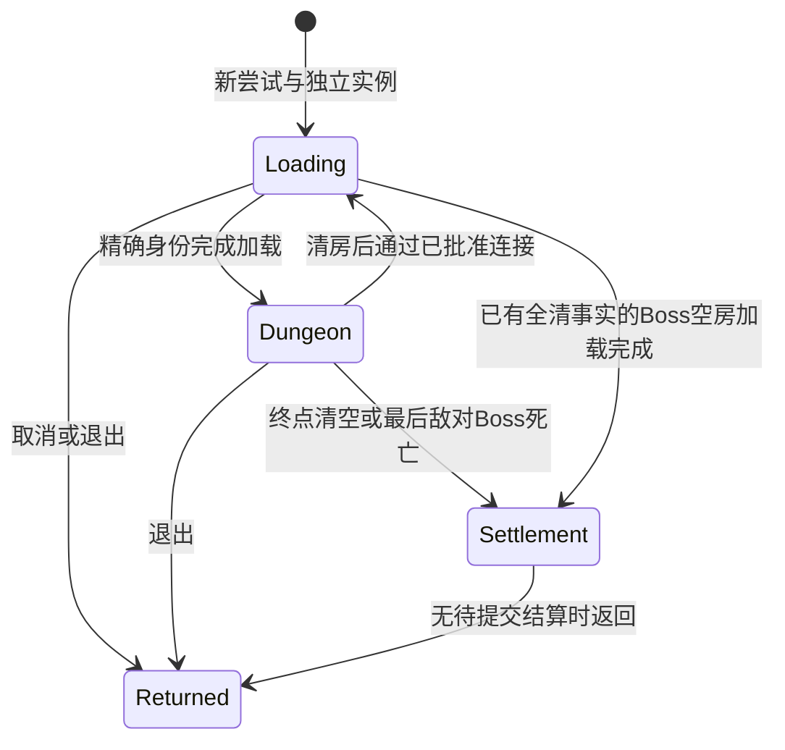

# 正式单人实例领域底座

## 当前合同与范围

[SinglePlayerDungeonRun](../../Server/DfoServer/Game/Dungeons/SinglePlayerDungeonRun.cs)提供独立单人实例的内存生命周期、房间对象身份和已确认事件去重。它已由GameSession私有正式状态接入3145入场、加载、原生统计死亡核验、成长事务、冻结掉落拾取、过房、Boss确认、通关经验及退出；翻牌道具、金币和费用暂时为空，任务事务未接入，不表示完整副本已验收。所有合法职业及转职角色均可走入场；后续特殊职业和转职成长仍受[角色成长](角色成长.md)的既有范围约束，不由入场替代成长资格。既有[诊断实例](../../Server/DfoServer/Development/Dungeons/DungeonProbeRun.cs)由独立开发模块管理；其 `ReportDeath` 不是正式死亡事实来源，也不参与本领域底座的状态转换。

资源结构及原码边界见[副本资源解析](../资源/副本目录.md)、[副本选择与固定场景](../协议/副本.md)。当前 `DungeonCatalog` 保留 greed 原文，提供 AA..PP→0..15 的线性索引、原文偏移及逐 maze Unsupported，并通过 `StaticTopology` 检查显式地图的门墙出口、双向连接和可达性。静态连接通过仍不能证明动态门、特殊传送和正式准入资格。当前仅正式接入匹配Dungeon 3 / 3145静态路线与原生本地统计来源，不外推动态门或特殊传送；缺少 `approvedRoute` 或 `combatAuthority` 时 `TryCreate` 返回 Unsupported，不把测试中的合成怪物与战斗事实用于正式玩法。

## 状态与身份

`DungeonRunIdentity`包含角色 ID、任务 ID、TaskAttempt、实例 Guid 和当前 epoch。开局角色 revision 单独保存在 `StartCharacterRevision`，不参与所有后续事件的永久身份比较；正式持久化必须以当次角色 revision 作 CAS，合法的经验或掉落事务不会使实例身份失效。

调用方在账号 owner gate 内分配任务尝试并建立实例，每次挑战分配新实例及新的尝试/epoch。完成加载、接受过房、结算和退出会推进 epoch；房内死亡事件不逐次推进 epoch，以允许同一房间生命周期内的多个已确认事件。epoch 不回绕，并为终止预留空间。断线、重选与 owner 更替由会话层使旧实例失效；本底座不负责 owner 或持久化，也不提供重启恢复。

## 调用接口

- `TryCreate(entry, taskAttempt, initialEpoch, approvedRoute, combatAuthority, out run, out reason)`：只在身份、完整房间计划、明确连接和正式战斗输入能力齐备时建立 Loading 实例。
- `CompleteLoading(identity, actionId)`：仅当前 Loading 状态可接受，随后更新 epoch。
- `Move(identity, actionId, target)`：仅当前 Dungeon 状态、本房清空、实际声明的连接及已规划目标房间可接受。
- `Return(identity, actionId)`：可在 Loading、Dungeon 或 Settlement 取消/退出；待提交死亡或结算期间拒绝，接受后成为 Returned。
- `AcceptConfirmedDeath(confirmedEvent)`：只接绑定战斗事件来源签发的类型化事实，禁止直接传入客户端的死亡字段。
- `PrepareConfirmedDeath(confirmedEvent)`：核对同样的死亡资格并冻结待提交候选，当前死亡集、epoch及清图状态不变；精确重放返回同一候选。候选提供提交后快照及可能的清图事实，供持久化事务使用。
- `ConfirmCommittedDeath(prepared)`：存储明确提交后，在原实例owner内确认准备对象并发布冻结结果。重复确认只返回Duplicate，不再次输出清图事实。
- `CancelUncommittedDeath(prepared)`：仅在存储明确未提交或已回滚时撤销准备，使原事件ID可再次准备。旧候选、另一实例候选或重新构造的候选不能确认或撤销当前准备。
- `ClearFact`：末次死亡提交确认后保留唯一只读清图事实；复制字段不能替代原对象取得结算资格。
- `PrepareSettlement(fact, reportBody, reward)`：冻结首份报告和奖励；精确重复复用原准备，报告或奖励改变时拒绝。
- `ConfirmCommittedSettlement(prepared)`：仅原实例当前准备可确认；重复确认不重复发奖，提交结果不明时保留同一准备查询receipt。

返回值包含 Accepted、Duplicate、Rejected 或 Unsupported，以及只读当前快照。已接受 action 的 ID 与完整输入保存在实例内；精确重放只返回 Duplicate，不重新切房、推进 epoch 或输出清图事实。复用 ID 修改身份、动作或目标被拒绝。未接受过的旧 epoch 输入被拒绝；已接受的旧事件重放可以识别为 Duplicate，且没有业务副作用。

## 路线与房间边界

`DungeonFixedRoute`是领域准入计划输入，包含全部房间怪物计划及显式双向连接；资源定义及门墙资格仍归 `GameWorld`。连接只能由已审核的匹配资源规则提供，或在 C# 单测中明确作为合成 fixture。底座不解析 PVF，也不根据相邻坐标自动补连接。

创建时要求房间与 entry 的显式 map specification 完整对应，坐标唯一且位于边界内，start/boss 确实存在；连接端点存在、距离为一个格、无重复，全部房间从起点可达。即便地图相邻，只要没有明确连接，也不能穿墙。怪物计划按[副本模块](副本.md)支持的固定普通/Boss及精确本服Lv1规则重新核验，传入等级与生成类型必须与同一原资源行的规划值一致；未知生成条件、缺失行、重复怪物 key、角色 key 冲突或不完整计划不能变为空房。

普通地图种类沿用目录解析的`map`，Boss为`boss`；`normal`不是地图目录的合法种类，不与怪物的`[normal]`品级混淆。回归以真实3145地图身份、静态连接及明确合成怪物/战斗来源验证字段可接入底座，不能将该测试视为真实怪物或正式副本已经支持。

房间死亡集按坐标保存，回访已清房间不会重生怪物。同一实例所有房间 key 唯一；新实例可以拥有相同数值 key，但旧实例/尝试/epoch 的事件不能影响新对象。被动对象、buff、碰撞、机关及其他机制没有在此底座中实现；其存在不构成已实现交互的声明，生产准入仍须有独立资格，未知机制不能因为目录可读取而默认支持。

## 战斗事件与结算

`DungeonCombatAuthority`只是正式战斗组件的事件签发能力合同，不是已经实现的伤害、HP、命中或防作弊系统，也不是 Runtime 默认创建的服务。实际战斗组件只有在服务端解析已确认死亡后才可签发 `ConfirmedDungeonMonsterDeath`；事件携带完整实例身份、非空 event Guid、monster key 及正的唯一战斗事件序号。不存在 `bool died=true` 的网络成功入口。

[NativeDungeonCombatAuthority](../../Server/DfoServer/Game/Dungeons/NativeDungeonCombatAuthority.cs)解释匹配客户端的[死亡统计报告](../协议/副本.md#过房与怪物死亡的字段)，并永久绑定同一实例。`RewriteFlag`区分客户端写入报告的两种统计方式；“改写”指客户端重写统计前缀，服务端不会修改收到的数据。

两种报告都须匹配当前实例身份、已加载房间中的敌对活对象、本人角色及参与者类型`0x0111`，并通过正文检查值校验。报告等级必须等于生成计划等级；`SpawnHpSnapshot`是客户端创建时的HP快照，必须大于0；本人累计HP降低量`CumulativeHpDecrease`和本人正降低次数`PositiveHpDecreaseCount`也必须大于0。

- **未改写报告（`RewriteFlag=0`）**：`Unknown18`表示该怪物全部来源的累计HP降低量加随机扰动，`Unknown26`表示该怪物全部来源的正降低次数。要求`Unknown26 >= PositiveHpDecreaseCount`，且`Unknown18 >= CumulativeHpDecrease`、`Unknown18 >= SpawnHpSnapshot`。总次数可以大于本人次数，总量与本人累计量的差值不另设门限，本人累计量也可以小于创建HP；普通攻击和控制技能采用相同规则。
- **Boss改写报告（`RewriteFlag=1`）**：只支持Dungeon 3、任务3145、Boss地图76126中的固定Boss模板107000903，生成类型3、等级3，资源行须同时声明`[fixed]`和`[boss]`。要求`CumulativeHpDecrease >= SpawnHpSnapshot`；前缀`Unknown18`和`Unknown26`须满足[协议文档](../协议/副本.md#过房与怪物死亡的字段)列出的改写量与派生次数公式。此时这两个字段不再表示该怪物的实际累计量和实际次数，不能套用未改写报告的比较条件。其他非零标志不支持。

完整正文指纹由网络转换计算。以上规则只检查客户端死亡报告的相容性，不提供服务端逐次伤害模拟；检查值和统计字段也不提供身份认证或奖励额度。

首次全部资格通过才签发事件与序号；本房精确重放返回同一事实，任意观察或正文指纹变化拒绝。明确SQL回滚后可用原事实重新Prepare；加载、旧房、旧epoch、退出及换实例不能借缓存签发，Settlement仅识别原Boss房末次事实的一次epoch推进。解释器不消费死亡、不写库、不发包；生产调用归正式Session私有owner，经Prepare/成长SQL/Confirm发布实际结果，诊断ReportDeath不调用它。当前路线普通/控制技能击杀与Boss通关的实机确认见[副本模块](副本.md)。

实例校验事件来源是否为开局绑定的同一能力对象，并核对当前 Dungeon 状态、完整身份、本房 monster key、事件 ID/序号及是否已死亡。一个已死亡 key 不能被另一事件重复击杀。未经匹配战斗合同核验的客户端上报、诊断`ReportDeath`、资源模板或测试事件均不得作为真实战斗的确认依据。

房间清理依据阻塞对象的已确认死亡，友方对象继续保留。终点清图要求当前位置为Boss房、前方批准路线的阻塞对象已清、至少存在一个接受过的死亡事件；当前终点阻塞对象全清，或真实敌对Boss全部死亡时，才输出一次并保留`DungeonClearFact`，进入Settlement。剩余友方或普通对象不会被伪造成击杀事实，也不获得经验或掉落。该事实用于通关经验资格，不代替任务完成、领奖或下一任务事务。

`DungeonClearFact`只供后续正式事实 owner 接入核验，不直接修改完成任务表、任务条件、Gold、SP/TP、经验或物品。正式奖励/任务提交还须核验账号 generation、实例与尝试身份、当次 revision，并在同一事务写入事实去重和业务结果。提交后发送失败不能导致重新执行死亡或赠送。

`AcceptConfirmedDeath`保留纯内存一步确认行为，不能用于“接受死亡→提交经验SQL”的奖励路径。正式事务应先调用`PrepareConfirmedDeath`；准备期间，新的死亡、过房、退出及旧的一步确认入口均被拒绝，精确重放仍能取得原候选。每实例最多保留一个待提交候选，不创建后台任务，也不持有网络或数据库等待的共享锁。调用方负责在同一owner内串行使用这些接口。

SQL明确回滚后撤销准备，再以原死亡事件ID重试；提交结果不明时保留候选并查询持久化receipt，不能撤销后重发奖励。明确提交后调用`ConfirmCommittedDeath`，再发布Selected与通知。末次死亡在准备时已冻结清图身份与事件集合，重试不生成新的死亡ID；确认前实例仍处于Dungeon，确认后才进入Settlement。候选是内存对象，不是数据库提交凭据；接口本身不检查SQL结果，也不提供进程重启恢复。已有[本服经验仓储及receipt](角色成长.md#成长事务与发布前提)，正式成长、普通消耗品掉落拾取与通关经验调用链已接入；任务奖励未接入。

正式事实owner仍须同事务保存稳定事件身份、业务结果及角色revision，区分未提交、已提交但内存尚未确认、已确认但未通知。Duplicate只证明当前内存已见事件，不证明数据库已经提交；持久化同ID重放还须核对完整来源与输入，同ID不同载荷拒绝。进程重启、owner更替及SQL失败时如何恢复待提交事实，须与正式战斗来源一同定义并验证，不能由本底座的内存去重替代持久化去重。

## 通关经验与空翻牌

[GameSession.Settlement](../../Server/DfoServer/Game/Session/GameSession.Settlement.cs)持有同一正式Run的报告、展示结果及翻牌状态。末次39产生已提交ClearFact后，启用115→31结算；117必须匹配当前Boss的本人、对象key、生成等级与Authority已核验创建HP，只协调已有事实，不签发死亡。协议合同与包序见[Boss确认与通关结算](../协议/副本.md#boss确认与通关结算)。

[DungeonClearExperienceCatalog](../../Server/DfoServer/GameWorld/Dungeons/DungeonClearExperienceCatalog.cs)采用`dungeon-clear-base-rank-v1`规则，优先参考外部服务端的基础与评分公式，并读取本服PVF声明：

- 基础经验为 `floor(任务经验表[basis level - 1]整数对首项 × 副本experience increasing point × 难度经验倍率)`；缺失或负权重取中性1，显式0、非有限值及表外范围拒绝。
- 评分经验为 `floor(基础经验 × 评分倍率)`。八个下降评分阈值的前五档对应五个倍率，最高档取末项倍率，低于第五档不加评分经验；展示档位仍保留全部八档。
- 总通关经验为两者之和。角色等级、访问房数及已经授予的击杀经验不再参与基础倍率；不另乘未使用的clear exp bonusrate，也不加入会员、活动、付费或任务奖励。

首次46报告先通过既有成长预检，再冻结报告字节、原角色快照、奖励、清图事件与稳定事件ID。[CommitDungeonSettlement](../../Server/DfoServer/Persistence/CharacterRepository.Settlement.cs)复验账号、实例、任务尝试和完整学习前提，在同一事务更新经验、等级、两树SP与revision，并写入v10的`character_dungeon_settlement_receipts`。账本与击杀receipt独立，按角色/实例唯一，保存完整清图身份、报告、基础/评分经验、规则及资源路径、提交前后经验/等级和revision；迁移只建空表，不补历史经验，也不依赖PVF哈希。

SQL结果不明时保留原准备、报告和expected，暂拒返回与拾取；重试先查询持久receipt，已提交的同份结果只安装实际持久角色，不再加经验或SP。确认后的同报告复用冻结结果，修改报告拒绝。发布34→37→35使用当前generation、选角epoch、实例身份与角色引用门禁；击杀总经验仅作35展示，37展示本次通关增量与实际累计结果。发送失败不重跑奖励，断线或换角不恢复旧内存Run。

69→70→71只推进评分滚动、翻牌展示及空结果确认，不修改资产。72的焦点、回城、再挑战和选其他副本归Session/Handler；再挑战创建新Run并预留新attempt/key，选其他副本通过后续真实15建立完整选择上下文。翻牌道具、金币、费用、任务条件、下一任务、付费及会员奖励继续保持未实现，其他迷宫和既有特殊成长门禁不扩大。

## 验证与待接入

[SinglePlayerDungeonRunTests](../../Server/DfoServer/SelfTests/SinglePlayerDungeonRunTests.cs)使用 C# 明确合成路线及测试事件来源，覆盖错误角色/任务/尝试/实例/epoch、加载门禁、来源不匹配、未知 monster、重复及篡改事件、未清房、越格/缺连接、合法过房、回访、全清唯一事实、新挑战隔离和取消后迟到加载。真实匹配 PVF 用于验证缺失正式路线时的拒绝边界，以及静态地图连接配合合成怪物与战斗来源时的模型接入；这些用例不代表实际战斗通过。

同一C#回归还覆盖准备不消费事件、精确重复准备、篡改载荷、待提交门禁、回滚后的同ID重试、旧候选与跨实例隔离、末次死亡的冻结清图结果，以及重复确认不再次结算。这是合成领域验证，没有执行真实奖励SQL或客户端经验通知。

`NativeDungeonCombatAuthorityTests`接入无资源Core入口，使用明确合成的统计和路线验证各项资格、完整u64比较、稳定重放、回滚重新准备、加载/回访/退出/跨实例及Settlement重复。这些测试不提供Windows正常击杀证据；完整Parser、生产调用、SQL提交与通知还须分别回归。

[FormalDungeonSessionTests](../../Server/DfoServer/SelfTests/FormalDungeonSessionTests.cs)通过普通角色创建及正式Session接口验证资源路线、成长边界、两树SP、真实文件SQL回滚、owner/选角隔离及存量未知状态拒绝。[FormalDungeonTcpTests](../../Server/DfoServer/SelfTests/Tcp/FormalDungeonTcpTests.cs)属于`formal-dungeon`组，连接默认正式模块，独立编码死亡统计，核对加载、死亡及成长完整帧、六房过图、重复/校验/旧key拒绝，以及实际停服重启后的经验和身份高水位。[FormalDungeonPublicationTests](../../Server/DfoServer/SelfTests/FormalDungeonPublicationTests.cs)经正式Parser/Handler及真实文件库注入晚期SQL回滚、已提交返回值丢失、首/次通知写入故障和等待时重选，核对原候选/receipt重放、连接收尾、已提交状态恢复与旧通知隔离；退出等待时另建实例也不能发布旧城镇切图或同屏成员。死亡输入为明确合成数据，不能替代客户端普通攻击或实际升级验收。

生命周期用例通过 `--selftest` 执行，公共验证命令见[贡献指南](../../CONTRIBUTING.md#验证)。请求包序、门墙资格、地图机制、战斗解析、事务事实/奖励、掉线恢复及客户端实际副本仍需随功能分别验证。

[DungeonSettlementTests](../../Server/DfoServer/SelfTests/DungeonSettlementTests.cs)、[通关经验规则测试](../../Server/DfoServer/SelfTests/DungeonClearExperienceCatalogTests.cs)、[结算Session测试](../../Server/DfoServer/SelfTests/DungeonSettlementSessionTests.cs)及[结算协议测试](../../Server/DfoServer/SelfTests/DungeonSettlementProtocolTests.cs)提供合成规则、冻结报告、SQLite回滚/幂等恢复、成长边界、状态与包体验证。客户端字节合同来自匹配静态读取；当前路线的Boss通关与空翻牌结算已获Windows实机确认，再挑战等其他界面分支仍需分别验收。
