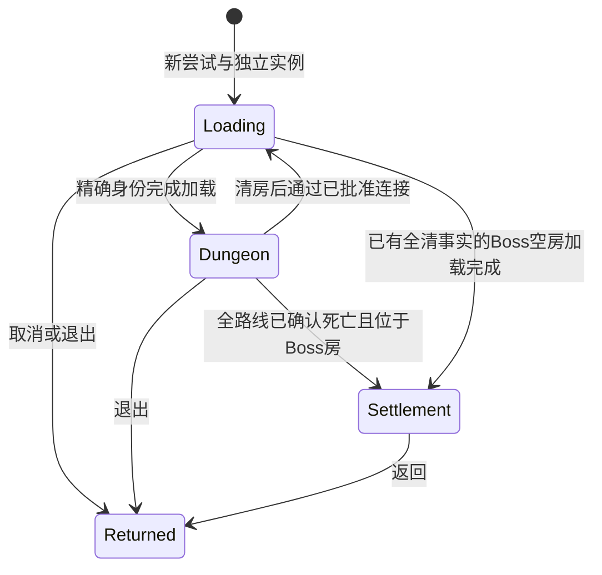

# 正式单人实例领域底座

## 当前合同与范围

[SinglePlayerDungeonRun](../../Server/DfoServer/Game/Dungeons/SinglePlayerDungeonRun.cs)提供独立单人实例的内存生命周期、房间对象身份和已确认事件去重。它没有接入正式入场信令、战斗、奖励、掉落、经验或任务事务，不表示副本可玩。既有[诊断实例](../../Server/DfoServer/Development/Dungeons/DungeonProbeRun.cs)由独立开发模块管理；其 `ReportDeath` 不是正式死亡事实来源，也不参与本领域底座的状态转换。

资源结构及原码边界见[副本资源解析](../资源/副本目录.md)、[副本选择与固定场景](../协议/副本.md)。当前 `DungeonCatalog` 保留 greed 原文，提供 AA..PP→0..15 的线性索引、原文偏移及逐 maze Unsupported，并通过 `StaticTopology` 检查显式地图的门墙出口、双向连接和可达性。静态连接通过仍不能证明动态门、特殊传送和正式准入资格。真实 Dungeon 3 / 3145 尚未接入正式路线与战斗来源；缺少 `approvedRoute` 或 `combatAuthority` 时 `TryCreate` 返回 Unsupported，不把测试中的合成怪物与战斗事实用于正式玩法。

## 状态与身份

`DungeonRunIdentity`包含角色 ID、任务 ID、TaskAttempt、实例 Guid 和当前 epoch。开局角色 revision 单独保存在 `StartCharacterRevision`，不参与所有后续事件的永久身份比较；正式持久化必须以当次角色 revision 作 CAS，合法的经验或掉落事务不会使实例身份失效。

调用方在账号 owner gate 内分配任务尝试并建立实例，每次挑战分配新实例及新的尝试/epoch。完成加载、接受过房、结算和退出会推进 epoch；房内死亡事件不逐次推进 epoch，以允许同一房间生命周期内的多个已确认事件。epoch 不回绕，并为终止预留空间。断线、重选与 owner 更替由会话层使旧实例失效；本底座不负责 owner 或持久化，也不提供重启恢复。

## 调用接口

- `TryCreate(entry, taskAttempt, initialEpoch, approvedRoute, combatAuthority, out run, out reason)`：只在身份、完整房间计划、明确连接和正式战斗输入能力齐备时建立 Loading 实例。
- `CompleteLoading(identity, actionId)`：仅当前 Loading 状态可接受，随后更新 epoch。
- `Move(identity, actionId, target)`：仅当前 Dungeon 状态、本房清空、实际声明的连接及已规划目标房间可接受。
- `Return(identity, actionId)`：可在 Loading、Dungeon 或 Settlement 取消/退出；接受后成为 Returned。
- `AcceptConfirmedDeath(confirmedEvent)`：只接绑定战斗事件来源签发的类型化事实，禁止直接传入客户端的死亡字段。

返回值包含 Accepted、Duplicate、Rejected 或 Unsupported，以及只读当前快照。已接受 action 的 ID 与完整输入保存在实例内；精确重放只返回 Duplicate，不重新切房、推进 epoch 或输出清图事实。复用 ID 修改身份、动作或目标被拒绝。未接受过的旧 epoch 输入被拒绝；已接受的旧事件重放可以识别为 Duplicate，且没有业务副作用。

## 路线与房间边界

`DungeonFixedRoute`是领域准入计划输入，包含全部房间怪物计划及显式双向连接；资源定义及门墙资格仍归 `GameWorld`。连接只能由已审核的匹配资源规则提供，或在 C# 单测中明确作为合成 fixture。底座不解析 PVF，也不根据相邻坐标自动补连接。

创建时要求房间与 entry 的显式 map specification 完整对应，坐标唯一且位于边界内，start/boss 确实存在；连接端点存在、距离为一个格、无重复，全部房间从起点可达。即便地图相邻，只要没有明确连接，也不能穿墙。当前仅接收既有固定普通怪物生成形状；未知生成条件、缺失行、重复怪物 key、角色 key 冲突或不完整计划不能变为空房。

普通地图种类沿用目录解析的`map`，Boss为`boss`；`normal`不是地图目录的合法种类，不与怪物的`[normal]`品级混淆。回归以真实3145地图身份、静态连接及明确合成怪物/战斗来源验证字段可接入底座，不能将该测试视为真实怪物或正式副本已经支持。

房间死亡集按坐标保存，回访已清房间不会重生怪物。同一实例所有房间 key 唯一；新实例可以拥有相同数值 key，但旧实例/尝试/epoch 的事件不能影响新对象。被动对象、buff、碰撞、机关及其他机制没有在此底座中实现；其存在不构成已实现交互的声明，生产准入仍须有独立资格，未知机制不能因为目录可读取而默认支持。

## 战斗事件与结算

`DungeonCombatAuthority`只是正式战斗组件的事件签发能力合同，不是已经实现的伤害、HP、命中或防作弊系统，也不是 Runtime 默认创建的服务。实际战斗组件只有在服务端解析已确认死亡后才可签发 `ConfirmedDungeonMonsterDeath`；事件携带完整实例身份、非空 event Guid、monster key 及正的唯一战斗事件序号。不存在 `bool died=true` 的网络成功入口。

实例校验事件来源是否为开局绑定的同一能力对象，并核对当前 Dungeon 状态、完整身份、本房 monster key、事件 ID/序号及是否已死亡。一个已死亡 key 不能被另一事件重复击杀。客户端上报、诊断 `ReportDeath`、资源模板或测试事件均不得作为真实战斗的确认依据。

本底座的保守机械全清规则要求全部批准路线房间的怪物已有正式确认死亡，当前位置为 Boss 房，并且至少存在一个接受过的死亡事件。只有此时输出一次 `DungeonClearFact`并进入 Settlement；全空路线在创建阶段拒绝，加载完成本身不会凭空产生死亡事实。此全清规则不等同于已经闭合的 3145 条件或任何奖励资格。

`DungeonClearFact`只供后续正式事实 owner 接入核验，不直接修改完成任务表、任务条件、Gold、SP/TP、经验或物品。正式奖励/任务提交还须核验账号 generation、实例与尝试身份、当次 revision，并在同一事务写入事实去重和业务结果。提交后发送失败不能导致重新执行死亡或赠送。

现有 `AcceptConfirmedDeath` 会立即修改内存死亡集、事件集合和序号，末次死亡还会进入 Settlement；同一事件重放只返回 Duplicate，不再次输出 ClearFact。因此后续接入不能直接采用“接受死亡→提交经验SQL”的顺序：SQL失败后，内存已消费事件，而数据库尚无奖励事实。当前没有生产奖励调用链，此处是接入前必须解决的协调条件，不是已发生的在线奖励故障。

正式事实 owner 必须让经过核验的待提交事实在失败后仍可恢复。协调顺序为无副作用准备与资格核验、同事务提交稳定事件身份/业务结果/角色revision、确认内存与Selected、最后发布通知；不能仅将现有Accept移到SQL之后而省略提交前的领域准入检查。恢复须区分未提交、已提交但内存尚未确认、已确认但未通知，不能撤销死亡后重新生成奖励ID，也不能让 Duplicate 自动再次发奖。Duplicate只证明当前内存已见事件，不证明数据库已经提交；持久化同ID重放还须核对完整来源与输入，同ID不同载荷拒绝。进程重启、owner更替及SQL失败时如何恢复待提交事实，须与正式战斗来源一同定义并验证，不能由本底座的内存去重替代持久化去重。

## 验证与待接入

[SinglePlayerDungeonRunTests](../../Server/DfoServer/SelfTests/SinglePlayerDungeonRunTests.cs)使用 C# 明确合成路线及测试事件来源，覆盖错误角色/任务/尝试/实例/epoch、加载门禁、来源不匹配、未知 monster、重复及篡改事件、未清房、越格/缺连接、合法过房、回访、全清唯一事实、新挑战隔离和取消后迟到加载。真实匹配 PVF 用于验证缺失正式路线时的拒绝边界，以及静态地图连接配合合成怪物与战斗来源时的模型接入；这些用例不代表实际战斗通过。

生命周期用例通过 `--selftest` 执行，公共验证命令见[贡献指南](../../CONTRIBUTING.md#验证)。该领域模型没有正式网络或奖励接入；请求包序、门墙资格、地图机制、战斗解析、事务事实/奖励、掉线恢复及客户端实际副本仍需随功能分别验证。
